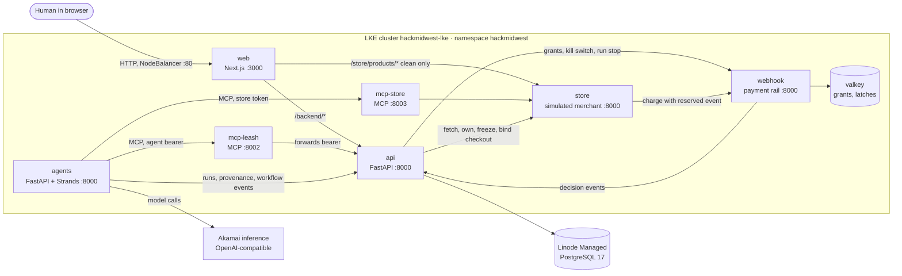

# Leash architecture as built

**Repo:** [`RishiMadhavan-ui/hackmidwest-2026`](https://github.com/RishiMadhavan-ui/hackmidwest-2026)
on GitHub. It's private, so you need to be added as a collaborator to read it.

Two snapshots matter:

- **main** at `713ddb1`: merged. Includes the protected local-rail charge.
- **Graph branch** `aditya/strands-graph` at `eea65d2`: pushed, **not merged**.
  Adds the Strands Graph, human launch and run-scoped execution. It conflicts
  with main in six files.

## One-paragraph version

Everything runs as separate containers on one Akamai/Linode Kubernetes Engine
(LKE) cluster. A Next.js web app is the only public entry point. Behind it, a
FastAPI backend owns users, mandates, payment decisions and the audit log, and
is the only service that writes to PostgreSQL. The shopping agent is a Strands
agent in its own pod. It reaches the outside world only through two MCP servers:
one for payments (which forwards to the FastAPI backend) and one for shopping
(which talks to a simulated merchant). A separate payment-rail service makes
authorization decisions using only Valkey. Strands and the LLM are never in the
authorization path; every allow/block decision is plain code.

## Diagram

On the Graph branch, both MCP servers also call `POST /execution/authorize` on
the API to check the run-scoped credential on every tool call.

## The pods

All run with 1 replica on a single `g6-standard-4` node in `us-central`. Images
are built for amd64 by `scripts/deploy_lke.sh` and pushed to the configured
registry.

| Pod | Stack | Port | Job |
|---|---|---|---|
| `web` | Next.js 16 (App Router), TypeScript | 3000 | UI. Proxies `/backend/*` to the API, streams activity (SSE), serves the clean merchant listing. Only public pod, via a `LoadBalancer` Service (Linode NodeBalancer) on port 80 |
| `api` | FastAPI, Python 3.12, Pydantic v2 | 8000 | The trusted backend: auth, mandates, runs, payment checks and grants, audit log, Kill Switch, operator Attack Lab. Only writer to PostgreSQL |
| `agents` | FastAPI hosting the Strands shopper and guardian | 8000 | Runs shopping agents; 5 Gi volume for the trace outbox |
| `mcp-leash` | Official MCP Python SDK, Streamable HTTP | 8002 | 4 payment tools, each forwarding to one API route |
| `mcp-store` | Official MCP Python SDK, Streamable HTTP | 8003 | 3 shopping tools against the merchant, plus page evidence |
| `store` | FastAPI | 8000 | Simulated merchant "Volt Supply Co.": catalog, listings, owned and frozen checkouts, charge through the rail |
| `webhook` | FastAPI | 8000 | Payment rail: local rail simulator, plus a Lithic ASA adapter that isn't used for purchases yet |
| `valkey` | Valkey 8 with AOF, 5 Gi volume | 6379 | Grants, idempotency cache, account and run stop latches, rail event stream |

Outside the cluster: **Linode Managed PostgreSQL 17** (`hackmidwest-db`) and the
**Akamai inference endpoint** the agents call for model completions.

Network policies allow only the rail to reach Valkey, and only the API, store
and web to reach the rail. Public MCP proxies are off by default. The only rail
path exposed publicly is the HMAC-signed Lithic webhook `/rail/lithic/asa`.

The merchant uses separate credentials: one for browsing and creating checkouts
(used by the Store MCP) and a different one for owning, freezing, binding and
completing (backend only, plus the Store MCP's `complete_checkout`).

## Where Strands sits

Strands lives entirely in the `agents` pod.

**On main:**

- A single Strands `Agent` named `leash-shopper`
  (`services/agents/shopper/agent.py`). It's intentionally gullible: the demo is
  that Leash blocks the bad purchase even when the agent falls for the attack.
- Model: `make_model()` in `shared/leash_shared/llm.py` builds a Strands
  `OpenAIModel` pointed at Akamai inference (OpenAI-compatible, model
  `hackathon-chat`), with explicit token limits.
- Tools come only from two Strands `MCPClient`s, one per MCP server, each with
  its own credential. There are no direct Python shopping or payment tools.
- `ProvenanceHooks` record every tool call before and after it runs, and every
  page fetched, and send them to the API as untrusted evidence.
- Two modes: `live` uses the model. `scripted` is a labeled fixture ("Simulated
  compromised agent") that makes fixed choices but still makes real MCP calls.
- Guardian (`services/agents/guardian`): deterministic checks plus an optional
  LLM investigator at temperature 0. Advisory only.
- Runs start through `POST /runs` on the agents service with an internal service
  token. There's no button for it in the web app.

**On the Graph branch** (`services/agents/shopper/workflow.py`, `runtime.py`,
`control.py`):

- A Strands `Graph` with conditional edges:
  authority → shopping → verification → investigation → recovery → shopping, plus
  payment and terminal nodes.
- Each shopping attempt gets a fresh agent context. Recovery passes only the
  unchanged mandate, reason codes and exclusions (quarantined checkout IDs, SKUs,
  source URLs), never the poisoned page text or earlier transcripts.
- Hard limits: 3 candidates, 20 node runs, 45 s per node, 150 s total, 18 model
  calls, 30 MCP calls. Model retries are off.
- `control.py` claims the run with a human launch ID, renews a short lease, and
  checks for cancellation before and after every node, tool and model call.
- Graph steps are reported to the API's new `POST /workflow-events`, which adds
  them to the same history and SSE stream the web app reads.
- `POST /runs` now refuses to start without a human launch's `run_id` and
  `launch_id`.

## How the FastAPI backend fits

The API is the hub. Everything that grants, denies or records authority goes
through it.

**Human path:** browser → `web` → `/backend/*` → `api`

- Sign up and sign in (custom JWT). Signup creates identity only.
- Draft, review, confirm (Ed25519-signed), replace and revoke mandates.
- Kill Switch and per-run stop.
- Activity history and live SSE stream, replayed from PostgreSQL.
- Attack Lab (main): `GET /attack-lab/status`; allowlisted operators can preview
  the poisoned listing. Starting a scenario returns 503 until isolated fixtures
  exist.
- *Graph branch:* `POST /agent-runs/launch` creates a run for a confirmed mandate
  and returns a one-time launch ID.

**Agent path:** Strands → MCP server → `api`

1. The run is registered with the API, bound to the confirmed mandate's exact
   version and hash. *Graph branch:* the worker claims it with the launch ID and
   keeps renewing its lease.
2. `mcp-leash` forwards the agent's bearer token to the API unchanged. The API
   decides what that token may do.
3. Hooks post tool traces and fetched-page evidence to `POST /provenance`.

**Payment path on main** (`request_payment` → `POST /payments`):

1. Record a durable payment operation and reserve its IDs before contacting
   anyone.
2. Fetch the checkout from the store, then have the store own and freeze it for
   this run.
3. Recheck that the account, run and mandate are still current.
4. Run the 15 checks (see `LEASH_ENFORCEMENT.md`).
5. If they pass: bind the checkout at the store, install a single-use grant in
   the rail, and return a once-only instrument token. If not: `blocked`.
6. The agent calls `complete_checkout`. The store sends the reserved event to the
   rail's `/local/authorize`. The rail decides and consumes the grant, and the
   decision flows back to the API's activity log and the web app.

The Graph branch has its own version of steps 2 to 6
(`api/purchase_execution.py`, `api/merchant_execution.py`,
`services/store/execution_bridge.py`, `services/webhook/execution_routes.py`),
used when the request carries a run-scoped execution token. Main and the branch
need to settle on one implementation when they're merged.

## Database

PostgreSQL migrations in `db/migrations/`, applied at API startup with
checksums: users and auth, mandate authority, cards, activity feed, workflow
control, card controls, payment attempts and operations, then
`0011_payment_authorization.sql` (main's local-rail grants) and
`0012_execution.sql` (Graph launches, leases and activation states).

## Where to look in the repo

| Area | Path |
|---|---|
| FastAPI backend | `api/` (`main.py`, `mandate_service.py`, `payment_service.py`, `checkout_verifier.py`, `workflow_control.py`, `attack_lab.py`) |
| Graph-branch execution API | `api/execution.py`, `purchase_execution.py`, `merchant_execution.py`, `workflow_events.py` |
| Shared models and events | `shared/leash_shared/models.py`, `events.py`, `llm.py` |
| Strands agent | `services/agents/shopper/`, `provenance/`, `guardian/`; Graph notes in `services/agents/graph-handoff.md` |
| MCP servers | `services/mcp-leash/main.py`, `services/mcp-store/main.py` |
| Merchant | `services/store/` |
| Payment rail | `services/webhook/` (`decide.py` is the pure policy) |
| Web app | `web/src/` |
| Kubernetes and deploy | `k8s/`, `scripts/deploy_lke.sh`, `scripts/lib.sh` |
| Rules and status | `AGENTS.md`, `api/r03-r11-handoff.md`, `docs/LEASH_SPEC.md` |
