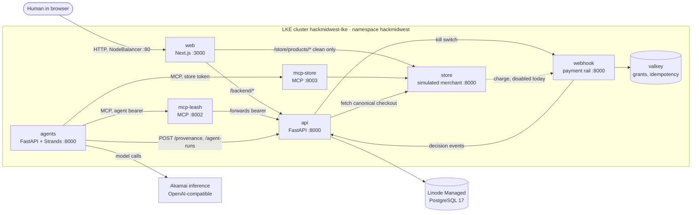

# Leash architecture as built

**Repo:** [`RishiMadhavan-ui/hackmidwest-2026`](https://github.com/RishiMadhavan-ui/hackmidwest-2026)
on GitHub. It's private, so you need to be added as a collaborator to read it.
This page describes `main` at commit `138d636`. Work in progress on other
branches is labeled.

## One-paragraph version

Everything runs as separate containers on one Akamai/Linode Kubernetes Engine
(LKE) cluster. A Next.js web app is the only public entry point. Behind it, a
FastAPI backend owns users, mandates, payment decisions and the audit log, and
is the only service that writes to PostgreSQL. The shopping agent is a Strands
agent in its own pod. It reaches the outside world only through two MCP servers:
one for payments (which forwards to the FastAPI backend) and one for shopping
(which talks to a simulated merchant). A separate payment-rail service makes
card authorization decisions using only Valkey. Strands and the LLM are never in
the authorization path; every allow/block decision is plain code.

## Diagram

## The pods

All run with 1 replica on a single `g6-standard-4` node in `us-central`. Images
are built for amd64 by `scripts/deploy_lke.sh` and pushed to the configured
registry.

| Pod | Stack | Port | Job |
|---|---|---|---|
| `web` | Next.js 16 (App Router), TypeScript | 3000 | UI. Proxies `/backend/*` to the API, streams activity (SSE), serves the clean merchant listing. Only public pod, via a `LoadBalancer` Service (Linode NodeBalancer) on port 80 |
| `api` | FastAPI, Python 3.12, Pydantic v2 | 8000 | The trusted backend: auth, mandates, runs, payment checks, audit log, Kill Switch. Only writer to PostgreSQL |
| `agents` | FastAPI hosting the Strands shopper and guardian | 8000 | Runs shopping agents; 5 Gi volume for the trace outbox |
| `mcp-leash` | Official MCP Python SDK, Streamable HTTP | 8002 | 4 payment tools, each forwarding to one API route |
| `mcp-store` | Official MCP Python SDK, Streamable HTTP | 8003 | 3 shopping tools against the merchant, plus page evidence |
| `store` | FastAPI | 8000 | Simulated merchant "Volt Supply Co.": catalog, listing pages, checkouts |
| `webhook` | FastAPI | 8000 | Payment rail: local rail simulator and a Lithic ASA adapter |
| `valkey` | Valkey 8 with AOF, 5 Gi volume | 6379 | Grants, idempotency cache, stop latch, rail event stream |

Outside the cluster: **Linode Managed PostgreSQL 17** (`hackmidwest-db`) and the
**Akamai inference endpoint** the agents call for model completions.

Network policies allow only the rail to reach Valkey, and only the API, store
and web to reach the rail. Public MCP proxies are off by default. The only rail
path exposed publicly is the HMAC-signed Lithic webhook `/rail/lithic/asa`.

## Where Strands sits

Strands lives entirely in the `agents` pod.

- **Shopper (on main):** a single Strands `Agent` named `leash-shopper`
  (`services/agents/shopper/agent.py`). It's intentionally gullible: the demo is
  that Leash blocks the bad purchase even when the agent falls for the attack.
- **Model:** `make_model()` in `shared/leash_shared/llm.py` builds a Strands
  `OpenAIModel` pointed at the Akamai inference endpoint (OpenAI-compatible,
  model `hackathon-chat`), with explicit token limits.
- **Tools:** the agent has no direct Python shopping or payment tools. It loads
  its tools from two Strands `MCPClient`s, one per MCP server, each with its own
  credential.
- **Hooks:** `ProvenanceHooks` record every tool call before and after it runs,
  and every page fetched, and send them to the API as untrusted evidence.
- **Two run modes:** `live` uses the model. `scripted` is a labeled fixture
  ("Simulated compromised agent") that makes fixed choices but still makes real
  MCP tool calls. Each mode has its own agent credential.
- **Guardian:** `services/agents/guardian` has deterministic checks plus an
  optional LLM investigator at temperature 0, exposed as
  `POST /guardian/evaluate`. Its output is advisory, and the API doesn't call it
  yet.
- **In progress, not merged:** branch `aditya/strands-graph` builds a Strands
  `Graph` (authority → shopping → verification → investigation → recovery →
  payment/terminal) with bounded retries and cooperative stop.

Runs start through `POST /runs` on the agents service, which requires an
internal service token. There's no button in the web app that starts a run yet.

## How the FastAPI backend fits

The API is the hub. Everything that grants, denies or records authority goes
through it.

**Human path:** browser → `web` → `/backend/*` → `api`

- Sign up and sign in (custom JWT). Signup creates identity only; no card and
  no spending authority.
- Draft, review, confirm (Ed25519-signed), replace and revoke mandates.
- Kill Switch and per-run stop.
- Activity history and live SSE stream, replayed from PostgreSQL.

**Agent path:** Strands agent → MCP server → `api`

1. The agent registers its run with the API (`POST /agent-runs`), binding it to
   a confirmed mandate's exact version and hash.
2. Tool calls go through `mcp-leash`, which forwards the agent's bearer token to
   the API unchanged. The API decides what that token may do.
3. Hooks post tool traces and fetched-page evidence to `POST /provenance`.

**Payment path:** `request_payment` → `POST /payments`

1. The API records a durable payment operation before contacting anyone.
2. It fetches the checkout directly from the store with its own credential,
   never trusting the agent's version.
3. It runs 15 deterministic checks against the confirmed mandate (see
   `LEASH_ENFORCEMENT.md`).
4. It persists the result and an audit event, then streams it to the web.
5. **Today it stops here with `blocked`.** The next steps, issuing a single-use
   grant to the rail, binding it to the checkout at the store, and the store
   charging through the rail, exist in pieces but are disabled until durable
   reconciliation is finished.

**Rail path (built, not reached yet):** store → `webhook` `/local/authorize` →
Valkey atomic check-and-consume → decision → relayed to the API's
`/internal/activity` → shown in the web app.

## What's real on main and what isn't

| Real and tested | Not yet |
|---|---|
| All 8 pods' code, manifests and deploy script | Confirmation that the cluster runs `138d636` (a demo deployment exists; its revision is unverified) |
| Human mandate confirmation and signing | Any approved payment: every request returns `blocked` |
| 15-check verifier against the merchant's checkout | Grant issuance, merchant binding, charge completion |
| Strands agent with MCP tools and provenance hooks | Strands Graph recovery (branch only), guardian in the payment path |
| Rail single-use grants, Kill Switch invalidation, idempotency | Live Lithic sandbox authorizations |
| Persisted audit log with SSE replay | A UI button to start an agent run |

## Where to look in the repo

| Area | Path |
|---|---|
| FastAPI backend | `api/` (`main.py`, `mandate_service.py`, `payment_service.py`, `checkout_verifier.py`, `workflow_control.py`) |
| Shared models and events | `shared/leash_shared/models.py`, `events.py`, `llm.py` |
| Strands agent | `services/agents/shopper/`, `provenance/`, `guardian/` |
| MCP servers | `services/mcp-leash/main.py`, `services/mcp-store/main.py` |
| Merchant | `services/store/` |
| Payment rail | `services/webhook/` (`decide.py` is the pure policy) |
| Web app | `web/src/` |
| Kubernetes and deploy | `k8s/`, `scripts/deploy_lke.sh`, `scripts/lib.sh` |
| Database schema | `db/migrations/` (0001–0010) |
| Rules and status | `AGENTS.md`, `docs/LEASH_SPEC.md`, `docs/LEASH_ALIGNMENT_AUDIT.md` |
