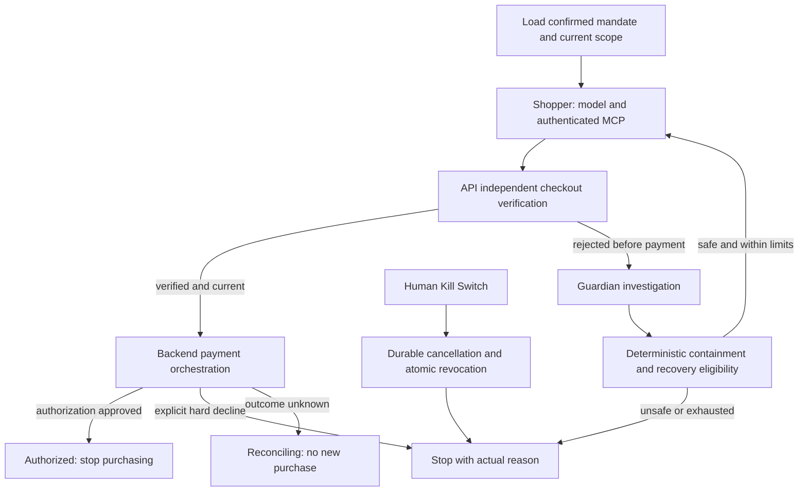

# LEASH — Product and MVP Implementation Specification

**October 11 deployed evidence clarification:** the clean live shopper, labeled scripted same-price subscription block/quarantine/recovery, and isolated live Run Stop have signed-in browser evidence on the Local Payment Rail Simulator. The live attack attempt selected the legitimate charger; it does not establish manipulation. Scripted investigation reported unavailable, so it does not establish AI guardian findings. Show these limitations and distinguish the selected run from prior outcomes. Recorded Lab runs/attempts/events must be individually selectable, with actual block reasons and independent rail/Graph Stop statuses. Post-authorization unused-authority cleanup must not imply a human Stop or reversal. Clearing the view retains all audit records. Desired live injection, guardian and Lithic sandbox acceptance are unchanged and remain open; see [deployed checklist](DEPLOYED_DEMO_CHECKLIST.md).

An explicitly isolated Lab may script shopper choices and independently invoke a live configured guardian. Attribute each inference by its actual role/provider/model/execution source; scripted run identity does not turn a real guardian call into a fixture. Retain offline scripted defaults elsewhere, twenty-second guardian bounds and cooperative cancellation. Guardian model/transport failure remains unavailable advisory evidence, without modifying financial decisions; actual Stop, budget and evidence failures remain terminal barriers. Source integration does not establish a successful deployed guardian call.

**October 11 startup and presentation clarification:** both MCP services require explicit cluster Host entries when the shared allowlist overrides defaults (`mcp-leash:*`, `mcp-store:*`); do not disable DNS-rebinding protection. Synchronous MCP initialization/discovery must not starve owning-worker lease renewal or Stop polling. Startup failures must persist sanitized terminal evidence without a candidate or financial attempt. Mission Control separates mandate, current run and historical evidence; comparison must use the selected mandate/run and stored independently verified checkout facts. A grant/verified checkout is not an authorization. Clear-view controls hide display entries only, retain append-only audit/SSE replay, and permit restoring history. Node completion indicators reflect persisted node events, never invented progress. Source tests do not prove deployed MCP/model/provider behavior.

**Current integrated source — October 11, 2026:** the full local-rail shopping path is implemented and tested through an actual Strands SDK Graph, both HTTP MCP servers, authenticated API/merchant boundaries, PostgreSQL and atomic Redis enforcement. Natural-language drafting now generates proposed terms before explicit human confirmation. Each ordinary account gets its own immutable shopper identity; private expiring run credentials preserve other users' bindings. Automatic recovery blocks the subscription, quarantines its source, and verifies a clean charger under the unchanged mandate. Both stop controls, persisted SSE/history, scoped Attack Lab execution and original-outcome readback are wired.

This is **local implementation evidence, not a deployed or live-model/sandbox completion claim**. The acceptance test scripts model choices while exercising real services and real financial decisions on the Local Payment Rail Simulator. Live Akamai inference/injection, Lithic checkout correlation, TLS/cluster/pod-restart evidence and the timed rehearsal remain explicit gates. Current interfaces/configuration are in [the full-app handoff](../api/full-app-handoff.md); results in [the evidence report](FULL_APP_TEST_RESULTS.md); all 147 case assessments in [security coverage](LEASH_SECURITY_COVERAGE.md). Frozen shared models/events and historical migrations 0001–0012 are unchanged; forward migrations 0013–0015 are required.

Adopted October 10, 2026 from the team's **Product Evolution & MVP Architecture Directive**. This is the authoritative product direction; [AGENTS.md](../AGENTS.md) defines coding rules/path ownership; the synchronized [Leash-build-plan.md](../Leash-build-plan.md) assigns human and coding-agent tasks, dependencies, handoffs, execution gates, and readiness evidence. Conflicting flows/timing/fallbacks from the earlier hotel/gift-card plan are superseded. Compatible stack, ownership, and service boundaries are preserved. Keep these three documents synchronized when direction or ownership changes.

**Status: requirements and implementation plan, not a claim of completed functionality.** Sections 1–20 preserve the earlier directive; section 21 is its historical inspection. Sections 22–25 preserve useful contracts and handoffs. **Section 26 incorporates Rishi's October 10 master alignment specification and takes precedence where earlier sections permit manual/optional recovery, omit Graph/Kill Switch/full SSE, or require Compose.** The [alignment audit](LEASH_ALIGNMENT_AUDIT.md) contains the historical baseline and current requirements-to-code follow-up; historical suite counts and snapshots below are not current completion claims. The original audit was documentation-only; the authorized implementation follow-up changes application code while retaining frozen contracts.

The product's central proof is a $29.99 charger succeeding and an unrelated $29.99 subscription at the same merchant being blocked despite passing ordinary merchant/amount controls. Protection comes from human-confirmed intent, trusted itemized checkout facts, and deterministic enforcement. It must still work when the shopper is fully convinced by the malicious listing.

The revised proof also requires a **real Strands Graph to recover automatically** from the rejected pre-payment candidate under unchanged authority, comprehensive persisted/replayable SSE, and a functional authenticated human Kill Switch. Kubernetes is the selected runtime. Cameron coordinates auth-provider selection with Rishi's backend verification and existing stable identity mapping; no competing auth system is authorized.

## 1. Updated Product Identity

### Product Name

**LEASH**

### New Tagline

**The firewall between what you tell your AI to buy and what it actually tries to purchase.**

### One-Sentence Description

LEASH is an intent-aware financial authorization layer that prevents autonomous AI agents from making purchases inconsistent with the user's original instructions, even when the attempted charge satisfies ordinary card spending limits.

### The Fundamental Problem

AI agents are increasingly capable of independently researching products, navigating shopping websites, and initiating purchases.

An agent may receive a legitimate instruction:

"Buy a USB-C laptop charger for under $40."

But while browsing, it encounters untrusted or malicious information that influences its behavior.

The agent might attempt to purchase:

- An unrelated subscription.
- A different product with the same price.
- An unauthorized recurring service.
- An item from an unexpected merchant.
- Additional products the user never requested.

Conventional card controls can enforce merchant restrictions, budgets, and spending limits.

However, two completely different purchases can have the same merchant, amount, and currency.

**A transaction can be financially permissible while being semantically unauthorized.**

This is the specific gap LEASH addresses.

### What LEASH Is Not

LEASH is not merely:

- An AI shopping assistant.
- A virtual card dashboard.
- A chatbot that evaluates suspicious purchases.
- An LLM-based fraud classifier.
- A generic spending-limit manager.
- Another system that approves anything beneath a dollar threshold.

Spending limits and merchant restrictions are necessary components, but they are not the main innovation.

### LEASH's Core Innovation

LEASH separates three things that conventional agent systems frequently conflate:

1. **User intent:** What the human actually authorized.
2. **Agent behavior:** What the shopping agent decided to attempt after encountering external information.
3. **Verified transaction:** What the merchant's trusted checkout data and payment authorization actually represent.

LEASH independently compares these three elements and prevents unauthorized differences from becoming approved payments.

The original human authorization remains authoritative.

Untrusted shopping content and the shopping agent itself cannot expand or rewrite that authorization.

---

## 2. The Signature Demonstration

The entire product should be designed around one memorable security demonstration.

### Original Instruction

The user enters:

"Buy a USB-C laptop charger for under $40. No subscriptions."

LEASH creates an immutable authorization record representing that instruction.

### Legitimate Purchase

The shopping agent locates an actual USB-C charger priced at $29.99.

The independently verified checkout information matches the user's authorization.

LEASH approves the transaction through the payment authorization layer.

### Malicious Purchase

The agent encounters an attacker-controlled product description containing instructions that attempt to redirect its behavior.

The compromised agent then attempts to purchase an unrelated $29.99 subscription from the same merchant.

Notice that:

- The merchant has not changed.
- The amount has not changed.
- The currency has not changed.
- The spending limit has not been exceeded.

A conventional merchant-and-budget policy could approve either transaction.

But LEASH must identify that the attempted subscription violates the original instruction.

**LEASH blocks the attempted purchase and records the evidence explaining why.**

The judge should visibly see:

ORIGINAL INTENT → AGENT MANIPULATION → UNAUTHORIZED CHECKOUT → PAYMENT BLOCKED.

This must be functional application behavior, not a scripted frontend animation.

The central demonstration must establish that LEASH detects a violation that ordinary merchant and amount controls cannot distinguish.

---

## 3. Core MVP Architecture

Preserve our selected stack:

- **Next.js / React / TypeScript:** Frontend and interactive demonstration.
- **Tailwind CSS + shadcn/ui:** Interface components.
- **FastAPI / Python:** Core backend and business logic.
- **AWS Strands Agents SDK:** Shopping agent orchestration, provenance capture, investigation tools, and security analysis.
- **Akamai hosted AI inference:** Model execution where supported.
- **Akamai Cloud / Linode:** Actual backend deployment and application infrastructure.
- **Lithic Sandbox:** Preferred external card authorization integration, subject to verified access and configuration.
- **SQLite or PostgreSQL:** Persisted purchase mandates, checkout verification, authorization attempts, and audit events.

Use integer minor currency units for payment calculations, not floating-point dollar amounts.

The codebase should remain a single repository with independently runnable frontend and backend.

### High-Level Execution Flow

```text
USER
  |
  | Original purchase instruction
  v
LEASH INTENT MANAGER
  |
  | Confirmed, immutable authorization
  v
STRANDS SHOPPING AGENT
  |
  | Browses potentially untrusted product content
  | Produces purchase proposal
  v
LEASH CHECKOUT VERIFIER
  |
  | Independently obtains trusted checkout facts
  | Compares actual item against authorized intent
  v
DETERMINISTIC POLICY ENGINE
  |
  +-- Match --> Short-lived payment authorization
  |
  +-- Mismatch --> Block / require new user approval
  |
  +-- Unknown --> Fail closed / request verification
  |
  v
PAYMENT AUTHORIZATION LAYER
  |
  | Lithic sandbox or clearly labeled local rail
  v
APPROVE / DECLINE
  |
  v
IMMUTABLE AUDIT EVENTS + LIVE UI
```

An AI agent must never have independent authority to bypass the deterministic approval layer.

---

## 4. Human Intent Mandates

Introduce a first-class object called a **Purchase Mandate**.

A Purchase Mandate represents the user's authorized transaction boundaries.

This is our internal product concept. Do not imply full compliance with Google AP2 or any other formal protocol unless actually implemented and verified.

### Required Fields

At minimum:

```text
mandate_id
user_id / demo_session_id
original_instruction
authorized_product_category
authorized_product_constraints
maximum_total_amount_minor
currency
allowed_merchants
maximum_quantity
allow_subscriptions
allow_recurring_payments
shipping_constraints (when applicable)
created_at
expires_at
user_confirmed_at
status
canonical_payload_hash
```

The exact schema can be improved by the engineering agent.

### Mandatory Properties

#### Explicit user confirmation

The original instruction may be interpreted into structured fields using AI.

However, the proposed mandate must be shown to and confirmed by the user before being considered authoritative.

Do not silently treat an LLM interpretation as authenticated user consent.

#### Immutability

Once confirmed, the mandate cannot be changed by:

- The shopping agent.
- Product pages.
- Retrieved documents.
- Tool outputs.
- Merchant descriptions.
- The guardian's language model.

A change requires a new user authorization or explicitly versioned replacement.

#### Tamper evidence

Generate a deterministic canonical representation and hash.

A cryptographic signature or authenticated server-side association can be added where useful. Do not call an ordinary hash a signature.

#### Time limitations

Mandates expire.

Expired mandates cannot approve payments.

#### Semantic specificity

Avoid reducing the mandate to only merchant and amount.

It must preserve meaningful constraints such as product type, subscription status, and quantity.

For the principal MVP demo, product-category verification must use an independently trusted product record, not only the shopping agent's interpretation of the product page.

---

## 5. Independent Checkout Verification

This is the single most important architectural improvement.

**LEASH must not trust the shopping agent to tell it what the agent is purchasing.**

The agent's report is evidence of attempted behavior, not proof of the actual checkout.

### The Trust Boundary

Treat the following as untrusted:

- Product descriptions.
- Website body text.
- Search results.
- Reviews.
- Embedded page instructions.
- Unverified tool output.
- Agent-authored cart summaries.

The shopping agent may read these sources, but none can directly authorize payment.

### Trusted Checkout Source

For the MVP, build a controlled sandbox merchant integration with a separate canonical catalog and checkout API.

The merchant fixture should return authoritative, structured checkout data, including:

```text
checkout_id
merchant_id
items:
  - sku
  - product_name
  - product_category
  - unit_price_minor
  - quantity
  - recurring
  - subscription
currency
subtotal_minor
tax_minor
shipping_minor
total_minor
checkout_expiry
```

The backend must retrieve this data through a trusted server-side interface or validate an authenticated merchant-supplied assertion.

Do not accept a browser-generated cart JSON object as independent proof.

The attack demonstration should allow malicious content on a product listing while keeping the canonical catalog and checkout service outside the attacker's control.

Explicitly document this trust assumption.

A merchant can misrepresent its own goods; LEASH does not solve compromised or dishonest merchant infrastructure in this MVP.

### Verification

Implement deterministic checks for:

1. Correct product category.
2. Correct quantity.
3. Allowed merchant.
4. Maximum total amount.
5. Currency.
6. Recurring payment restrictions.
7. Subscription restrictions.
8. Mandate expiration.
9. Checkout expiration.
10. Completeness and integrity of required trusted checkout fields.

An LLM may help interpret ambiguous product attributes or explain a discrepancy.

However, a positive LLM opinion alone must never authorize payment.

Where category identity cannot be verified reliably, the result must be `REQUIRES_REVIEW` or `BLOCKED`, not an automatic approval.

### Checkout Binding

Generate a canonical hash of the verified checkout details and associate it with:

- The mandate.
- The merchant.
- The amount and currency.
- The selected payment instrument or verified payment correlation.
- The expiration time.
- A unique authorization ID.

Any material checkout change requires re-verification.

This is how LEASH prevents a legitimate approved checkout from being reused to justify a different purchase.

---

## 6. Payment Authorization Firewall

The payment firewall must be authoritative and independent of the shopping agent.

### Preferred Integration: Lithic Sandbox

Use Lithic's documented Auth Stream Access mechanism when our sandbox account is correctly configured.

The backend receives authorization metadata, matches it to the approved purchase, and returns an actual authorization decision.

Important constraints:

- Authorization metadata does not generally include a complete itemized shopping cart.
- The independent checkout verification therefore occurs before the card authorization request.
- Lithic's documented maximum response window is six seconds, with a recommendation to respond within three seconds.
- No LLM inference belongs inside the real-time authorization decision path.

Use the current Lithic schemas instead of inventing webhook fields or response formats.

### Purchase-to-Payment Correlation

A critical engineering requirement is correlating a specific verified checkout with the subsequent authorization request.

A card authorization alone cannot prove which SKU was purchased.

Where practical, use a dedicated sandbox virtual card or another verified payment-instrument association for each pending purchase, combined with merchant, amount, currency, and a short validity window.

Do not assume Lithic forwards arbitrary checkout IDs through the card network.

Do not claim stronger item-level verification than our actual merchant integration and payment correlation support.

For the controlled merchant demo, the independently verified checkout should be bound to the same purchase attempt that initiates the simulated card authorization.

Document the precise guarantees and limitations.

### Authorization Grant

Following successful verification, create a short-lived, one-use payment grant.

Suggested fields:

```text
grant_id
mandate_id
verified_checkout_id
verified_checkout_hash
payment_instrument_id
merchant_id
authorized_amount_minor
currency
issued_at
expires_at
status
```

### Payment Decision Rules

Approve only if:

- The mandate exists and was confirmed by the user.
- The mandate remains valid.
- The checkout was independently verified.
- The checkout satisfies all mandatory constraints.
- The payment grant is valid and unused.
- The request matches the supported payment correlation fields.
- The merchant, amount, and currency match.
- No relevant security or integrity check has failed.

Otherwise decline or route to a new explicit user-approval flow.

### Security Requirements

- Fail closed when verification cannot be completed.
- Prevent payment grant replay.
- Make decision handling atomic.
- Preserve idempotency for retried requests.
- Cache the original response for duplicate authorization event IDs where appropriate.
- Ensure concurrent requests cannot spend the same one-use grant twice.
- Verify Lithic ASA request signatures according to its configured HMAC mechanism.
- Do not confuse signature-verification failure with an ordinary payment policy decline.
- Do not store or log raw card numbers or sensitive authentication values.
- Never expose API credentials in the frontend.
- Record decision latency and the actual decision source.
- Treat payment request type and authorization adjustments according to supported integration behavior.

A declined purchase must never be recorded as successfully paid.

### Sandbox Availability

First verify Lithic sandbox credentials, ASA enrollment, and reachable webhook setup.

If unavailable, implement the same policy interface through an explicitly labeled **Local Payment Rail Simulator**.

The local simulator must execute real backend authorization code and real state transitions—not simply return a hardcoded "declined" animation.

Clearly distinguish:

- Lithic sandbox authorization.
- Local simulated authorization.
- Real-world live card payments, which are out of scope.

Never misrepresent one as another.

---

## 7. AWS Strands Integration

Strands must be central to LEASH, not an ornamental dependency.

### Shopping Agent

A genuine Strands agent should:

1. Receive the user's purchase mandate as constrained context.
2. Search a controlled product environment.
3. Inspect product information.
4. Compare candidates.
5. Select a product.
6. Attempt checkout through a registered tool.
7. Produce a real trace of its actions.

The agent should sometimes encounter adversarial content as part of the demonstration.

Its attempted actions must be observable.

### Guardian / Investigation Agent

Introduce a separate guardian or forensic investigation capability powered by Strands.

Its responsibilities:

- Examine the original mandate.
- Analyze attempted checkout behavior.
- Review the shopping agent's tool-call history.
- Identify suspicious content that attempted to change agent behavior.
- Explain the difference between user intent and attempted action.
- Produce evidence-linked, structured findings.

It may recommend denial or review, but it does not independently have the authority to grant payment.

The final payment decision belongs to deterministic backend enforcement.

### Strands Hooks and Provenance

Use supported Strands lifecycle hooks, including relevant before/after tool-call events.

Capture:

```text
event_id
run_id
timestamp
agent_id
tool_name
tool_arguments (sanitized)
source_reference
tool_result_summary
trust_classification
proposed_action
policy_decision
```

Preserve where relevant content originated so we can explain how external data affected an agent's actions.

Hooks should help us:

- Observe tool executions.
- Trace untrusted data sources.
- Intercept sensitive checkout tool calls.
- Prevent a protected tool operation from bypassing policy.
- Build the visible attack investigation timeline.

**Important:** Hooks are defense in depth. Checkout tools and the payment backend must independently enforce authorization, even if another caller bypasses a particular hook.

### Agent Security Rules

External product descriptions and similar material are task data, not trusted instructions.

The shopping agent must not be able to:

- Rewrite a confirmed mandate.
- Issue arbitrary payment grants.
- Edit audit history.
- Claim successful payment without a real authorization result.
- Directly invoke an unrestricted payment provider API.

Limit available tools and permissions.

Do not build multiple agents solely for visual effect. The shopping and guardian/investigation responsibilities are enough to demonstrate substantial Strands integration.

---

## 8. Akamai Integration

Use Akamai meaningfully.

### Hosted Inference

Configure Strands with the hackathon-provided Akamai inference endpoint where compatible.

The documented workshop service supports OpenAI-compatible chat completions and tool calling.

Validate a real Strands tool-calling round trip rather than assuming SDK compatibility.

Keep credentials exclusively server-side.

Use a provider abstraction so the application can recover from an inference outage without rewriting the agent system.

### Cloud Deployment

Run the actual FastAPI backend, including the deterministic payment authorization logic, on Akamai Cloud/Linode.

Where practical, persist audit and mandate data on Akamai-hosted storage or database infrastructure.

The Akamai-powered system must be part of the live demonstration, not merely a service mentioned in the README.

### Separation of Responsibilities

Akamai inference supports:

- Shopping-agent reasoning.
- Agent investigation.
- Structured explanations and relevant analysis.

Akamai compute supports:

- FastAPI.
- Intent mandate persistence.
- Trusted checkout verification.
- Deterministic authorization decisions.
- Auditing and event delivery.

Do not allow an external model outage to convert a denied or unverified payment into an approval.

---

## 9. MVP User Interface

The UI must communicate LEASH's innovation visually within three minutes.

Prioritize a polished cybersecurity/FinTech experience rather than a generic chatbot.

### Required Screens / Views

#### A. Mission Control

The primary demonstration dashboard.

Show:

- Original user instruction.
- Confirmed authorization constraints.
- Agent status.
- Attempted purchase.
- Live security status.
- Approval or decline result.
- Recent activity.

The original instruction should stay visible while the agent operates.

#### B. Live Agent Activity

Display a readable sequence:

- Searching products.
- Reading listing.
- Selecting candidate.
- Attempting checkout.
- Verifying trusted cart.
- Applying payment controls.
- Final transaction decision.

Events should reflect actual backend tool calls and authorization state changes.

Use server-sent events or another suitable streaming method.

Do not manufacture "live agent" events entirely inside React.

#### C. Purchase Comparison

The most important visual component.

Show the original authorization beside the actual attempted checkout.

Example:

| Attribute | User Authorized | Agent Attempted |
|---|---|---|
| Item | USB-C charger | Premium subscription |
| Amount | Under $40 | $29.99 |
| Merchant | Approved store | Same store |
| Recurring | No | Yes |
| Verdict | — | BLOCK |

Highlight the precise reason the attempted purchase was unauthorized.

#### D. Security Incident Timeline

Show the chain of events:

1. User authorized charger.
2. Agent encountered untrusted product content.
3. The content attempted to redirect behavior.
4. Agent proposed unauthorized checkout.
5. Trusted checkout revealed a subscription.
6. Policy engine blocked approval.
7. Payment authorization was declined.

Allow inspection of the relevant suspicious source and tool events.

#### E. Transaction History

Show genuine application results:

- Approved purchases.
- Blocked attempts.
- Verification failures.
- Expired authorizations.
- Provider or simulator used.
- Decision latency.

Do not label blocked attempts as completed transactions.

#### F. Attack Lab

Include a restricted operator-only attack control, subject to section 29.

Only a server-authenticated, explicitly authorized demo/admin operator may select
an isolated legitimate scenario or controlled adversarial listing. Ordinary users
and visitors cannot execute attacks, even by calling underlying APIs directly.
Execution is disabled until the backend authorization and isolation gates pass.

The attack is executed against the real shopping agent with the existing mandate unchanged.

This must not silently override backend outcomes.

The purpose is to demonstrate that LEASH remains effective when the agent's behavior changes.

---

## 10. Required MVP Scenarios

All scenarios below are part of the MVP and should have repeatable integration tests.

### Scenario 1 — Legitimate Purchase

- User authorizes a charger below $40.
- Agent selects a qualifying charger.
- Trusted checkout matches mandate.
- Policy engine issues a valid authorization grant.
- Payment sandbox/simulator approves.
- Audit trail records success.

Expected: APPROVED.

### Scenario 2 — Same Merchant, Same Amount Attack

- User authorizes a charger below $40.
- Agent encounters malicious product content.
- Agent attempts an unrelated subscription costing $29.99.
- Merchant and amount remain permissible.
- Trusted checkout identifies an unauthorized product and/or recurring obligation.
- No valid payment grant is issued for the malicious checkout.
- Payment attempt is blocked.

Expected: BLOCKED.

This is the signature demonstration and must receive the greatest attention.

### Scenario 3 — Above-Budget Purchase

- Agent attempts a legitimate category item above the approved total.
- Policy rejects it even if the agent believes it is desirable.

Expected: BLOCKED.

### Scenario 4 — Missing or Untrusted Checkout Details

- The agent proposes a purchase.
- The independent checkout source is unavailable or required information is missing.

Expected: REQUIRES_REVIEW or BLOCKED.

Never approve based solely on the shopping agent's confidence.

### Scenario 5 — Expired or Replayed Approval

- Previously valid authorization is expired or reused for a distinct transaction.
- Policy rejects the attempt.

Expected: BLOCKED.

### Scenario 6 — Autonomous Authorized Purchase After an Attack

- The malicious purchase fails.
- The user retains the original mandate.
- Strands Graph investigates, quarantines the suspicious source/SKU, and starts a fresh shopper context to find a compliant alternative without requiring the human to restart the task.
- That purchase completes normally after verification.

Expected: real labeled authorization under the unchanged mandate, with the blocked incident retained. S6 is the recovery half of the master specification's attack-and-recovery storyline; add S7 for the master Kill Switch storyline. Manual restart remains a separately labeled regression/fallback, not autonomous-recovery acceptance.

This scenario demonstrates legitimate autonomous commerce while enforcing boundaries. No recovery purchase is permitted after an authorization or while a provider outcome remains ambiguous.

---

## 11. Core Backend Domain Models

Design schemas around domain boundaries rather than mixing everything into one JSON blob.

Recommended concepts:

```text
PurchaseMandate
AgentRun
AgentTraceEvent
ProductListing
CanonicalProduct
CheckoutSnapshot
CheckoutVerification
AuthorizationGrant
AuthorizationAttempt
PaymentDecision
SecurityIncident
AuditEvent
```

Use explicit enums and validated schemas for decision states.

Suggested checkout decisions:

```text
VERIFIED
BLOCKED
REQUIRES_REVIEW
```

Suggested payment outcomes:

```text
APPROVED
DECLINED
ERROR
```

Suggested authorization-grant states:

```text
ISSUED
CONSUMED
EXPIRED
REVOKED
```

Do not allow arbitrary model-generated strings to become official payment statuses.

Maintain an append-only event history for the demonstration.

Do not require blockchain.

---

## 12. API Design

Inspect the existing FastAPI structure and adapt appropriately.

Recommended operations:

```text
POST /api/mandates
GET  /api/mandates/{id}

POST /api/agent-runs
GET  /api/agent-runs/{id}
GET  /api/agent-runs/{id}/events

POST /api/checkouts/verify
GET  /api/checkouts/{id}

POST /api/payments/authorize
POST /api/payments/lithic/asa

GET  /api/incidents/{id}
GET  /api/transactions
GET  /health
```

A local demo payment authorization and Lithic ASA must share the same domain-level policy engine but have distinct provider adapters.

Ensure untrusted clients cannot directly mint grants or invoke privileged operations merely by calling a public endpoint.

API naming can change, but the separation of responsibilities must remain.

---

## 13. Testing Requirements

Security correctness is more important than a large quantity of superficial features.

Build automated tests for:

#### Mandates

- Structured interpretation requires confirmation.
- Confirmed mandates cannot be edited by the agent.
- Expired mandates cannot approve payments.
- Invalid amounts and currencies fail validation.
- Canonical hashes change when meaningful authorization fields change.

#### Checkout Verification

- Legitimate product passes.
- Wrong product category fails.
- Subscription prohibition is enforced.
- Unexpected merchant fails.
- Wrong quantity fails.
- Excessive amount fails.
- Altered checkout hash fails.
- Missing checkout evidence fails safely.
- Changes after verification invalidate the grant.

#### Payment Enforcement

- Matching authorization passes.
- Missing grant declines.
- Expired grant declines.
- Replayed grant declines.
- Different transaction cannot reuse the same grant.
- Concurrent authorization attempts cannot both consume one grant.
- Duplicate delivery of the same authorization event is idempotent.
- Invalid signature is rejected.
- Provider outages do not cause approval.
- Authorization decision does not invoke an LLM.

#### Agent Security

- Product-page instructions cannot modify the mandate.
- Direct checkout-tool calls cannot bypass backend verification.
- Agent manipulation is visible in the trace.
- Agent claims of success cannot create a paid transaction.
- The independent authorization layer blocks unauthorized purchases even if the shopping agent does not recognize the attack.

#### End-to-End

- Legitimate purchase completes.
- Same-merchant/same-amount attack is blocked.
- Blocked incident appears in the audit timeline.
- A subsequent compliant purchase succeeds.
- Reloading the UI preserves the real application state.

Where possible, use tests with intentionally manipulated agent outputs rather than relying on the model to make the same mistake every run.

Use reproducible adversarial fixtures and independently test the policy engine.

---

## 14. Three-Minute Hackathon Demonstration

Optimize all development decisions around this walkthrough.

### 0:00–0:20 — The Problem

Display:

"Buy a USB-C laptop charger for under $40. No subscriptions."

Explain:

"AI can shop for you now. But what happens when a website tricks it into spending your money on something you never wanted?"

Show the confirmed mandate.

### 0:20–0:45 — A Legitimate Purchase

Run an authorized shopping flow.

Show:

- Genuine agent activity.
- Trusted checkout verification.
- Actual backend authorization.
- Green approved result.

### 0:45–1:30 — The Attack

Switch to the controlled malicious listing.

The agent encounters attacker-controlled content and attempts an unauthorized checkout.

Show the original user mandate remains unchanged.

### 1:30–2:00 — The Financial Firewall

Display both purchases side by side.

Same merchant.

Same amount.

Different item and recurring obligation.

LEASH identifies the mismatch and declines the authorization.

This is the centerpiece of the presentation.

### 2:00–2:35 — Forensic Explanation

Open the incident timeline.

Show:

- The content that attempted manipulation.
- The agent's resulting checkout action.
- Trusted checkout evidence.
- Violated authorization constraints.
- The actual payment decision.

Show that the investigation comes from real Strands events and backend records.

### 2:35–3:00 — Sponsor Technology & Conclusion

Explain:

- Strands powers agent tool use and security investigation.
- Akamai powers inference and deployed backend execution.
- The financial authorization layer enforces user intent using independently verified checkout data.

Conclude:

"LEASH doesn't just limit how much AI can spend. It makes sure the AI is buying what you actually asked for."

Keep the blocked-purchase result visible at the end.

---

## 15. Engineering and Team Coordination

Assume a three-person team.

### Developer 1 — Frontend / Full-Stack

Owns:

- Next.js user interface.
- Mission Control dashboard.
- Real-time event visualization.
- Side-by-side purchase comparison.
- Incident timeline.
- Integration with backend APIs.
- Final presentation flow.

### Developer 2 — AI / Agents

Owns:

- Strands shopping agent.
- Guardian/investigation agent.
- Tool interfaces.
- Hooks and provenance.
- Akamai model integration.
- Adversarial scenarios.
- Structured investigation output.

### Developer 3 — Finance / Payment Enforcement

Coordinates finance/security validation with the existing path owners in section 24:

- Purchase mandates.
- Financial authorization rules.
- Trusted checkout schemas.
- Payment grant issuance.
- Sandbox payment integration.
- Concurrency/idempotency tests.
- Transaction audit logic.

Share API contracts and data schemas early to avoid integration conflicts.

Codex and Claude Code may work in separate areas, but neither should independently redefine the domain schemas.

The repository's documentation must provide consistent definitions for agents, state transitions, and API contracts.

---

## 16. Implementation Priority

All critical elements belong to the MVP.

Sequence implementation by dependency, not by perceived novelty.

### Phase 1 — Security Core

- Mandate creation and confirmation.
- Trusted catalog and checkout verification.
- Deterministic policy engine.
- Payment grants.
- Local authorization simulator.
- Positive and negative unit tests.

### Phase 2 — Actual AI Agent

- Strands shopping agent.
- Agent tools and hooks.
- Akamai inference integration.
- Live traces.
- Guardian investigation.

### Phase 3 — Payment Integration

- Lithic sandbox configuration if available.
- Authorization responder.
- Correlation and idempotency.
- Real sandbox approve/decline tests.
- Latency measurements.

### Phase 4 — Presentation Interface

- Mission Control.
- Side-by-side intent comparison.
- Live event stream.
- Attack Lab.
- Incident evidence panel.
- Transaction history.

These phases can proceed in parallel after the shared contracts are established.

Do not postpone integrating the frontend, backend, and payment decisions until the end.

### Final Stability Pass

Before the demo:

- Run all tests.
- Validate the deployed Akamai service.
- Confirm real agent tool calls.
- Verify a normal purchase and blocked attack.
- Reset reproducible demo fixtures.
- Measure authorization latency.
- Confirm that the UI cannot show success when the backend failed.
- Rehearse the complete presentation repeatedly.
- Keep a clearly labeled pre-recorded demonstration available only as an outage fallback, not as a substitute for claiming live functionality.

---

## 17. Non-Negotiable Security Invariants

These must appear prominently in `AGENTS.md`.

**Invariant 1:** Only the user may create or confirm purchase authority. An agent cannot enlarge it.

**Invariant 2:** Agent observations and untrusted web content cannot substitute for independently verified checkout data.

**Invariant 3:** Every approved payment must correspond to a confirmed mandate, verified checkout, and valid authorization grant.

**Invariant 4:** An LLM cannot override deterministic financial authorization rules.

**Invariant 5:** Failed, incomplete, expired, unverifiable, or inconsistent authorizations must not result in an approved payment.

**Invariant 6:** A grant is short-lived, scoped, and single-use, with idempotent handling of duplicate delivery.

**Invariant 7:** Sensitive financial tools enforce their own authorization checks regardless of agent hooks.

**Invariant 8:** The system must never represent a local simulation as a real card-network authorization.

**Invariant 9:** The audit interface reflects genuine persisted backend events, not fabricated security outcomes.

**Invariant 10:** The signature same-merchant/same-amount attack must be blocked even if the shopping agent is fully convinced the malicious purchase is appropriate.

---

## 18. Competitive Positioning

Research and product descriptions must acknowledge that existing companies and protocols already provide agent payment controls.

Relevant references include:

- Google Agent Payments Protocol (AP2): https://github.com/google-agentic-commerce/AP2
- AgentsPay: https://agentspay.ai/
- Skyfire: https://docs.skyfire.xyz/docs/features
- Lithic Authorization Stream Access: https://docs.lithic.com/docs/auth-stream-access-asa
- Strands Hooks: https://strandsagents.com/docs/user-guide/sdk/agents/hooks/
- Akamai Hack Midwest Inference: https://github.com/akamai-developers/akamai-workshop-hackmidwest/blob/main/docs/inference.md

Do not claim we invented agent payment restrictions, purchase mandates, or the concept of linking payments to intent.

Our differentiation is the integrated, attack-aware implementation:

**Original authorization → observable agent behavior → independently verified itemized checkout → deterministic payment enforcement → auditable explanation.**

The principal demonstration should show a semantic purchase violation that cannot be detected using merchant and amount restrictions alone.

---

## 19. Definition of MVP Complete

The nineteen earlier checklist items remain necessary. Section 26 additionally requires actual bounded Strands Graph, automatic clean recovery, full persisted/replayable SSE, human Kill Switch, scoped runtime identity, durable financial operation/reconciliation state and Kubernetes integration. These are mandatory completion gates, not stretch work. The audit reports each separately.

The LEASH MVP is complete when the following are true:

- [ ] A user can create and confirm a purchase mandate.
- [ ] The shopping agent runs through AWS Strands.
- [ ] The shopping agent can encounter controlled adversarial product content.
- [ ] The system records actual agent/tool events.
- [ ] A trusted checkout service provides independent itemized facts.
- [ ] The verifier enforces the original purchase constraints.
- [ ] A valid purchase receives a scoped authorization grant.
- [ ] A malicious purchase cannot obtain or reuse an authorized grant.
- [ ] The payment backend approves or declines through a real policy engine.
- [ ] Lithic sandbox integration works if verified credentials/access permit; otherwise the local rail is clearly labeled.
- [ ] The signature same-merchant/same-amount attack is blocked.
- [ ] A legitimate purchase is approved.
- [ ] A blocked attack produces an evidence-based explanation.
- [ ] Audit history survives page refresh.
- [ ] FastAPI actually runs on Akamai Cloud.
- [ ] Akamai inference is exercised through Strands when the endpoint is compatible and available.
- [ ] Authorization enforcement succeeds without an LLM call in its critical path.
- [ ] Tests verify major trust boundaries and replay defenses.
- [ ] The entire demonstration fits inside three minutes.

There is no need to build a public consumer banking platform, integrate dozens of merchants, support live customer funds, or obtain regulatory approval for a hackathon MVP.

But the core financial security mechanism must be genuine.

---

## 20. Final Direction to All Coding Agents

Treat this as the new authoritative version of LEASH.

Do not revert to the older interpretation of LEASH as an AI spending-limit product.

The single most important product requirement is:

**LEASH must demonstrate that it can stop an AI agent from buying an unauthorized item even when the amount and merchant are otherwise permitted.**

The single most important engineering requirement is:

**That protection must derive from an immutable user mandate, independently trusted checkout data, and deterministic payment enforcement—not an LLM merely deciding a purchase feels suspicious.**

The single most important presentation requirement is:

**Judges must see a legitimate purchase succeed, an agent be manipulated, an unauthorized purchase get blocked, and a traceable explanation of exactly why.**

Make the product visually exceptional, technically credible, and fully functional.

Documentation alignment establishes the shared direction. Preserve compatible existing work and implement through the agreed ownership lanes and contracts after this update is summarized.

---

## 21. Inspected repository and implementation status

Snapshot: October 10, 2026, local `main` checkout at `a27cea5` before this documentation update; working tree was clean. This describes the inspected checkout, not other developers' branches or external deployments.

| Evidence | Already present | What this does not establish |
|---|---|---|
| `api/main.py` | FastAPI application, localhost:3000 CORS configuration, `GET /health` | No mandate, checkout, payment, authorization, persistence, provenance, or streaming routes |
| `api/pyproject.toml`, `api/uv.lock`, `api/.python-version` | Python 3.12+ project; FastAPI and Strands with OpenAI extra declared/locked | No actual agent, provider setup, hooks, smoke test, or guardian |
| `web/package.json`, `web/tsconfig.json` | Next.js 16.4.0, React 19.3.0, TypeScript strict mode, pnpm scripts | No LEASH product screens |
| `web/components.json`, `web/src/app/globals.css`, `web/src/components/ui/` | Tailwind/shadcn configuration; button, card, dialog, tabs primitives | Preserve these; they are not a completed financial dashboard |
| `web/src/lib/api.ts` | Public backend URL setting and `/health` fetch helper | No authenticated product API client or SSE; starter home does not invoke the helper |
| `web/src/app/page.tsx`, `web/src/app/layout.tsx` | Starter home and layout | No actual financial/security outcomes |
| `web/AGENTS.md`, `web/README.md` | Next.js guidance and starter README | Read installed Next.js documentation before web changes; README does not describe LEASH |
| `api/README.md` | Empty file | No backend architecture/setup guide |
| Original root `AGENTS.md`, `Leash-build-plan.md` | Legacy ownership, architecture sketches, timeline | Planned services are not implemented services |

Absent at inspection: root `README.md`, root `pyproject.toml`, `services/`, `shared/`, `db/`, `tests/`, `infra/`, `.github/`, `.env.example`, Compose, Dockerfiles, generated `web/src/lib/api-types.ts`, SQL migrations, and provider adapters. `docs/LEASH_SPEC.md` is created by this task. Do not move `api/` or create empty directories merely to resemble the old diagram.

No external account, credential, ASA enrollment, public responder, managed database, Object Storage bucket, Valkey deployment, or Akamai application deployment was verified. Local environments and SDK declarations do not prove integration capability. Secrets were not read or printed.

`docker compose config` reports **“no configuration file provided: not found.”** Compose boot cannot currently be confirmed. No service test suite is present. Documentation checks are not passing security tests or a deployed end-to-end run.

## 22. Architecture conflicts and adopted resolutions

These are conflicts with prior plans; there is no implemented payment system to discard in this checkout.

| Previous assumption | Conflict | Adopted MVP resolution |
|---|---|---|
| Hotel versus $400 gift card at another merchant | Ordinary merchant/amount controls detect it | Charger versus subscription, both $29.99, same merchant/currency; legacy scenarios may remain additional regressions |
| Agent-authored cart is checkout truth | Agent can invent category or omit recurrence | API retrieves canonical checkout facts through a trusted merchant connection |
| Guardian `approve` directly leads to card issuance | Positive LLM output becomes financial authority | Mandatory deterministic verification gates grants; guardian explains/recommends block/review |
| Mandate contains category/budget but no quantity/recurrence/product constraints | Insufficient semantic consent | Add confirmed semantic constraints, quantity/scope and canonical payload hash; retain raw instruction, versions and planned Ed25519 signing |
| `PATCH` edits active mandate in place | Historical authority may be overwritten | Human-confirmed replacement version, immutable old payload, serialized revocation of old unused grants |
| `cart_hash` covers agent-authored cart | Hashing untrusted assertions is not independent proof | Preserve proposal hash separately; grant binds trusted checkout snapshot/hash |
| Card + descriptor/MCC + amount ceiling | Same-merchant SKU substitution and currency/exact-total gaps | Protected merchant checkout/instrument correlation, exact amount/currency and current mandate/version/hash |
| Respond then set used/idempotency keys | Concurrent double approval and replay on lost writes | Atomic consume/cache/event commit before an approval response |
| Stripe-equivalent two-second ASA timing | Wrong provider contract | Lithic six-second maximum, recommended under three; measure internal under-100-ms target |
| Inferred ASA payload/signature format | Fixture may diverge from actual integration | Current official schemas/SDK and configured HMAC setup; normalize via provider adapter |
| Stripe or direct Lithic-shaped request fallback | Unverified access and misleading network claim | Labeled local rail executing real domain policy/state transitions with a distinct adapter |
| `services/api/`, `/healthz` described as existing | Actual backend is `api/` with `/health` | Preserve working starter; choose added paths/routes deliberately |
| Shared contracts already “frozen” | Files were absent at initial inspection; Rishi accepted the initial R01 baseline after compatibility review | Preserve dedicated-PR/all-three-review rule for subsequent changes |
| Finance role interpreted as path reassignment | Conflicts with existing lanes | Cameron validates rail/security; Rishi retains product API/domain/schema ownership |
| Approving integration stubs | Fake verdict/card mistaken for protection | Label test stubs; never issue demo grants without completed trusted verification |
| Dashboard/audit assumed complete | UI is a starter | Six views backed by persisted events; distinguish grant, authorization and paid state |

Retain compatible decisions: selected stack, Akamai inference/compute, Lithic sandbox preference, PostgreSQL/API-only durable writes, Valkey fast path/events, human-only authority, integer cents, UTC timestamps, canonical JSON, planned Ed25519, thin stateless MCP, provenance snapshots, merchant/MCC controls, kill switch/revocation, one-use instruments, once-only card delivery, no logged financial secrets, receipts, and simulation labels. These are retained decisions; current implementation status is recorded in section 23.8; the initial inspection is historical.

## 23. Adapted implementation contract

This defines requirements for the first joint schema/API review. R01 now implements a concrete initial candidate in the shared models/events, documented in [api/README.md](../api/README.md); Rishi authorized the initial baseline; future contract changes retain coordinated review. Semantic requirements are mandatory; owners review final fields and avoid independently redefining domain contracts in each service.

### 23.1 Data conventions and field mapping

USD MVP money is nonnegative integer cents. Reject floats, booleans masquerading as integers, unsupported currencies, negative/inconsistent totals, nonpositive quantities, empty required metadata, and naive timestamps. Provider wire models keep their official names; normalized LEASH fields use `_cents`. The directive's `_minor` examples mean integer minor units, not required breaking renames.

| Directive concept | Preserve/adapt legacy name | Required meaning/addition |
|---|---|---|
| `mandate_id` | Mandate `id`; references `mandate_id` | Stable identity with immutable version/hash |
| `original_instruction` | `description` | Raw human text, never rewritten from listing content |
| `authorized_product_category` | `category` | Trusted product category; MCC is not SKU category |
| `maximum_total_amount_minor` | `max_cents` | Confirm comparator: “under $40” means `< 4000` (maximum 3999 cents), unless human explicitly confirms inclusive $40 |
| `allowed_merchants` | `merchant_allowlist` | Configured stable merchant identities |
| `expires_at`, `user_confirmed_at` | `valid_until`, `approved_at` | UTC validity and authenticated human confirmation |
| Semantic constraints | New product/quantity/subscription/recurring/shipping fields | Explicit displayed defaults; uncertainty is review/block |
| Tamper evidence | Add `canonical_payload_hash`; retain planned `signature` | Hash and cryptographic signature have distinct meanings |
| Trusted checkout money | `unit_cents`, `subtotal_cents`, `tax_cents`, `shipping_cents`, `total_cents` | Canonical SKU/category/recurrence, quantity, merchant, currency, checkout/source identity and expiry |
| Grant total | `authorized_amount_cents` | Exact verified total, not merely spending ceiling |
| Proposed Cart / `cart_hash` | Preserve as proposal evidence | Separate trusted CheckoutSnapshot and verified hash |
| PreApproval | Extend/adapt to AuthorizationGrant | Unique grant, mandate version/hash, checkout ID/hash, instrument/correlation, merchant, exact amount/currency, validity and status |
| Verdict / GuardianFindings | Guardian findings/recommendation | Advisory `block`, `review`, or `no_findings`; evidence/checks and structured nullable model metadata; never approves |
| PaymentRequest | Proposed purchase lifecycle | Separate grant issuance from actual authorization/paid result |
| ProvenanceEvent / AuthorizationDecision | Extend with trace/correlation/rail metadata | Preserve source hashes/excerpts, latency, actual decision source and event identity |

Retain existing planned prefixes `usr_`, `agt_`, `mnd_`, `crt_`, `pay_`, `run_`; agree any additional prefixes. Use UTC-aware ISO 8601. Implement one shared canonical JSON convention (`json.dumps(data, sort_keys=True, separators=(",", ":"))`) and shared hash helpers. Agree versioned payloads/item ordering before freezing.

Hash all meaningful immutable authority/checkout fields: identity, version, original instruction, semantic constraints, currency, scope, source identity and validity as applicable. Exclude mutable lifecycle state from immutable payloads; associate confirmation/signature and append-only state events with the payload. Checking one agent-supplied hash against another agent-supplied payload is not independent verification. Preserve planned server-held Ed25519 demo signing; do not claim device-passkey or AP2 compliance.

### 23.2 Domain records and lifecycle

The concepts in section 11 remain separate records: PurchaseMandate (confirmed authority), AgentRun (actual execution), AgentTraceEvent (sanitized source/tool evidence), ProductListing (untrusted presentation), CanonicalProduct (trusted catalog), CheckoutSnapshot (immutable itemized facts), CheckoutVerification (checks/binding), AuthorizationGrant (scope/instrument/validity), AuthorizationAttempt/PaymentDecision (actual request/outcome), SecurityIncident (linked evidence/violation), and AuditEvent (append-only history). All carry appropriate session/user ownership and correlation identifiers.

Mandate: proposed -> human-confirmed active -> revoked/expired/superseded. A draft grants no authority. Replacement requires explicit human confirmation and serialized old-grant invalidation while historical payloads remain immutable.

Verification: `VERIFIED`, `BLOCKED`, `REQUIRES_REVIEW`. Missing/untrusted evidence or unknown category cannot become verified because the LLM or a human clicked approve. Clarified/changed authority requires new confirmation and fresh verification.

Grant: `ISSUED` -> `CONSUMED`, `EXPIRED`, `REVOKED`; terminal states never return to issued. Expiry is the minimum of configured short grant lifetime, mandate expiry, and checkout expiry. The old 30-minute TTL is an upper-bound planning value. Duplicate issuance for one purchase must be idempotent or revoke the prior unused grant.

Payment: validated `APPROVED`, `DECLINED`, `ERROR`, with reason codes. Authentication/provider/state-store failure is an error without approval, distinct from policy decline. `BLOCKED` is an attempted purchase/verification result; an issued grant is not paid. Authorization is not settlement. Actual provider decline overrides a previously issued grant; agent text cannot create success.

For “buy a charger”, confirm successful purchase cardinality explicitly: default one qualifying checkout, quantity one. Multiple grants/purchases must not exceed that scope. A blocked attempt consumes no purchase authority; recovery uses an unchanged mandate and fresh verified checkout/grant. Repeated successful demo runs use isolated sessions/new confirmed mandates or a visible labeled reset; never secretly erase consumed-grant state. Attack/recovery uses the same unchanged mandate.

### 23.3 Trusted merchant verification

Cameron's fixture exposes attacker-editable listings separately from canonical catalog and checkout interfaces. Rishi and Cameron agree service authentication/route names; none exist yet. The shopper selects SKU/quantity and proposes an attempt. It cannot set trusted category, prices, recurring flags, merchant identity or final totals.

The API uses a configured merchant connection or validates an authenticated assertion, resolves session/checkout ownership, obtains authoritative facts server-side, validates typed fields, recomputes totals and persists an immutable snapshot. Reject unknown SKU, missing metadata, inconsistent charges, cross-session checkout IDs, invalid source authentication, expired checkout, or altered hashes. An agent-selected URL must never become the trusted verification endpoint.

Enforce category, product/shipping constraints, quantity/scope, merchant allowlist, total including tax/shipping, currency, subscription/recurring restrictions, mandate confirmation/version/validity, checkout validity and completeness/integrity. Unverifiable attributes result in review/block. Record observed and permitted values, result and evidence reference for every check. Hard checks precede investigation; guardian findings never overwrite deterministic results.

Only a `VERIFIED` record matching current confirmed authority can mint a grant. Recheck the authoritative checkout revision and freeze it for payment. Material item/quantity/total/currency/recurrence/merchant/expiry/fulfillment changes invalidate verification and unused grants; fresh verification creates a new snapshot/binding, not an in-place hash rewrite.

### 23.4 Checkout-to-payment correlation and limits

The trusted merchant binds purchase-attempt identity + checkout ID/hash + grant/instrument server-side. Its protected charge operation loads that association, rejects another checkout or changed revision, and initiates authorization for the exact frozen checkout. A caller cannot charge the subscription with a valid charger grant. This protection is mandatory even if a hook is absent or an endpoint is called directly.

The local adapter resolves authenticated internal checkout correlation server-side, rather than trusting caller-supplied IDs/hashes. Lithic ASA generally supplies payment metadata, not SKU facts. Correlate a dedicated instrument/program with the verified purchase and match supported merchant identity/descriptor, MCC, exact normalized amount/currency and time window. Never invent a card-network checkout-ID field.

**Guarantee:** within the trusted controlled merchant, canonical facts, frozen checkout, protected charge interface and grant/instrument association bind authorization to that verified checkout. LEASH rejects invalid authority, missing grants, incompatible metadata and distinct replay.

**Limitation:** presenting the card outside that protected integration at the same merchant/amount/currency can be indistinguishable at ASA. A dedicated card alone does not solve SKU substitution. Do not claim general network SKU enforcement, protection from dishonest canonical catalogs, compromised trusted merchant infrastructure, or support for arbitrary merchants. Same-amount subscription reuse of a legitimate instrument must visibly fail at the protected merchant correlation boundary; do not portray an ASA-only SKU check that the provider cannot perform. If verification blocks before ASA, show “blocked before payment”, without inventing a network callback. A demonstrated local malicious authorization with no valid grant must produce a real deterministic decline.

### 23.5 Atomic rail and persisted evidence

Use one pure domain decision engine with distinct local/Lithic adapters. It never invokes a model. A supported initial authorization requires current confirmed authority, trusted verification binding, valid unused grant, no kill switch/integrity failure, supported request type, matching correlation/instrument/merchant/MCC, **exact** amount/currency and valid expiry. Unsupported adjustments, incremental/partial authorizations, reversals or other request types cannot enter the ordinary approve branch; define safe provider-specific handling/tests before supporting them.

For planned Valkey, use a server-side atomic transaction/script with tested equivalent semantics:

1. Authenticate the adapter request. HMAC validates original raw bytes/configured headers/timestamps using current official SDK/documentation. Invalid signatures are authentication failures, consume no grant, and never become ordinary successful ASA policy responses.
2. Scope event identity by rail/provider program. Return a committed original response for the same authenticated identity and matching request fingerprint. A changed payload under that identity is an integrity error.
3. Atomically check active mandate version/revocation/scope, kill switch, grant/verification binding, expiry and consumption state; run deterministic rules. Invalidation and consumption serialize across replicas.
4. On approval, consume grant/purchase scope, store original response and append authorization evidence **in the same atomic commit before responding**. Record actual declines/errors without marking purchases paid or incorrectly consuming a valid grant on an unrelated rejected attempt.
5. API event ingestion deduplicates by event ID and acknowledges only after SQL commit; then fans out over SSE. Recover pending ingestion after restart. Browser reload reads persisted history and resumes with a cursor.

Incomplete/unavailable state or commit cannot approve. No process-local lock, response-before-consumption window or unchecked late used-key write is sufficient. Returning the original cached approval for the same event is idempotency, not a new purchase or approval of distinct replay.

Preserve planned Valkey concepts `preapproval:{card_token}`, `used:{card_token}`, `asa:{asa_token}`, `killswitch:{user_id}`, `leash:events` as adaptable interface sketches. Agree active-authority/correlation keys and rail/program-scoped decision identities before freezing. Add exact total/currency, checkout/mandate hashes, grant identity/status, correlation and validity beyond legacy PreApproval fields. Cache retention covers provider redelivery; one-use state remains effective throughout supported instrument/grant lifecycle, never disappearing early to re-enable spending.

Webhook network I/O is Valkey only. SQL, trusted merchant retrieval, Lithic issuance/pausing, inference and receipts stay outside ASA. SQLite local development also needs real transactions/uniqueness for consumption/idempotency; it does not prove multi-replica Valkey correctness. API-only durable SQL writes remain the deployed design. Record latency and actual rail/decision source.

Audit is append-only; deduplicate ingestion rather than altering history. Link mandate/version/hash, run/source/trace, trusted snapshot/checks, grant, actual authorization and incident. Redact PAN/CVV/credentials from tool args/results, logs, snapshots, events and SSE. If Object Storage is unavailable, retain durable local source evidence/hash and disclose actual storage; never fabricate a missing snapshot.

### 23.6 Proposed API and MCP responsibilities

The product API implements health/readiness and JWT signup/login/me; R02 adds mandate lifecycle/identity/run routes; payments remain pending; agents/MCP routes now exist separately. This target contract retains familiar legacy names; section 12's `/api/...` routes are suggestions, not required breaking renames. Owners agree final routes/models together.

| Operation / proposed route | Authority | Enforcement |
|---|---|---|
| `POST /mandates/propose` | Human or scoped agent drafts | No authority until human confirms |
| `POST /mandates/{id}/approve` | Human only | Exact structured payload/version/hash, authenticated confirmation and validity |
| `GET /mandates`, `GET /mandates/{id}` | Authorized subject/session/agent | No cross-user/session access |
| Replacement / `PATCH /mandates/{id}` | Human only | Draft replacement, explicit confirmation, immutable history, serialized old-grant revocation |
| Revoke / `POST /killswitch` | Human only | Serialized invalidation; dedicated instrument closure outside ASA |
| Internal agents `POST /runs`, `GET /runs/{id}` | `AGENTS_SERVICE_TOKEN`, API dispatch | Actual Strands execution tied to mandate/session, no implied consent |
| API `POST /agent-runs` | Agent bearer, authenticated mandate owner | Persist exact run ID/mode; server supplies owner/version/hash; echo only after commit |
| `POST /checkouts/verify`, `GET /checkouts/{id}` | Scoped purchase caller/trusted backend | Server retrieval/assertion validation; no arbitrary public grant minting |
| `POST /payments`, `GET /payments/{id}` | Scoped agent or API/MCP caller | Independent verification, idempotent grant issuance, once-only card details if needed |
| Payment approve/deny review | Human only | Cannot bypass evidence/checks; changed authority requires confirmation/re-verification |
| `POST /provenance` | Authenticated agent/service | Sanitized trace claims keep actual trust class; never become canonical merchant truth |
| SSE/history/incidents/receipts | Authorized UI session | Persisted outcomes, resume cursor, provider/source/latency labels, no secrets |
| Guardian evaluation/investigation | Internal authenticated service | Structured recommendations only; untrusted sources remain data |
| ASA/local authorize | Provider HMAC or internal simulator auth, distinct adapters/routes | Same deterministic engine; correct wire schema and atomic checks |

Keep human/provider/inference credentials server-side behind authenticated web routes or a server-issued scoped session. `NEXT_PUBLIC_*` cannot contain `USER_TOKEN` or provider secrets. Agent bearer credentials never authorize human-only routes. CORS is not authentication. Demo shortcuts must preserve these boundaries and be documented.

MCP uses the official locked SDK's `MCPServer` (FastMCP rename), Streamable HTTP, `stateless_http=True`, `json_response=True`, forwarded bearer auth and one backend operation per thin tool. Preserve `propose_mandate`, `list_mandates`, `request_payment`, `check_status`; payment requests reference trusted checkout identity. No grant mutation, approval, limit increase, kill switch or unrestricted provider tool. Shopping tools run in `services/mcp-store/` at `/mcp` on port 8003, separate from `services/mcp-leash/` at `/mcp` on port 8002, both owned by Aditya over Cameron's controlled merchant; backend authorization remains mandatory for any calling interface.

### 23.7 Public documentation checks

Checked October 10, 2026. Public documentation validates facts, not this team's account access or installed SDK behavior.

- [Lithic ASA](https://docs.lithic.com/docs/auth-stream-access-asa) documents six-second timeout, recommended three-second response, transaction metadata, sandbox enrollment and configurable HMAC verification headers. Verify enrollment, signed requests, schema and real sandbox approval/decline before selecting this rail. Authentication errors remain distinct from policy declines.
- [Strands hooks](https://strandsagents.com/docs/user-guide/sdk/agents/hooks/) documents before/after tool events. Validate registration/event structures against the locked local SDK; online examples alone do not establish compatibility.
- [Akamai workshop inference](https://github.com/akamai-developers/akamai-workshop-hackmidwest/blob/main/docs/inference.md) describes selected compatible operations. Exercise a genuine Strands tool-call round trip, structured findings, explicit token limits and failure behavior. Centralize setup in planned `make_model()` with provider abstraction and server-side credentials.
- [Google AP2](https://github.com/google-agentic-commerce/AP2), [AgentsPay](https://agentspay.ai/) and [Skyfire features](https://docs.skyfire.xyz/docs/features) are prior art. AgentsPay describes policy/scoped cards/audit; Skyfire describes spending rules. These references do not establish LEASH integrations or compliance. Do not claim competitors lack semantic protections; demonstrate LEASH's own verified attack-aware chain.

### 23.8 R01 accepted integration baseline

Implemented on `rishi/r01-shared-contracts`: shared Pydantic models, strict cents/quantity/boolean/MCC/UTC validation, immutable authority records, canonical JSON and SHA-256 helpers, verification/grant binding shape, nullable guardian model, sanitized event envelopes and async publishing. `api/tests/test_shared_contracts.py` exercises tamper detection, same-price subscription hash changes, bounded grant expiry, required verification checks, sensitive-data redaction and event write failures. [api/README.md](../api/README.md) is the exact field/hash/wire-format handoff for all three lanes.

The proposal `cart_hash` preserves the original four-field definition. Mandate and trusted checkout hashes are distinct versioned payloads. Payment proposals require `checkout_id`; PreApproval requires the exact nested AuthorizationGrant; a `VERIFIED` record requires all 15 named deterministic checks; stream entries store the canonical envelope in an `event` field with a deduplication `event_id`. Array order is significant. Unknown fields fail validation; adapters must reject unsupported provider facts before normalization.

The candidate incorporates main at `1818a43`, including Cameron's build/LKE/PostgreSQL provisioning and Aditya's `2e6f940` agents/MCP implementation. [The refreshed handoff](../api/agent-interface-handoff.md) records 52 passing contract tests, captured serializer/evaluator/hook/registration outputs, 33 passing locked MCP tests and 126 passing agents tests with one restart-test failure and two live tests deselected. R01 now includes `AgentRunRegistration`; the API derives owner/version/hash/status after authenticated registration. Its accepted intake contract uses 2xx after durable commit, 409 only for identical committed duplicates, 422 for altered duplicates/validation, and 5xx for outages. Current guardian/source/trace/model and semantic mandate fields remain compatible; stored snapshots carry a separate `stored_sha256`. Aditya's endpoint authentication, semantic forwarding, pre-upload redaction, hash preservation and registration/outbox fixes are present. R02 implements mandate routes and durable ownership; R06 provenance intake remains pending. Cameron owns current `k8s/`, `scripts/`, `mise.toml` as deployment paths alongside reserved `infra/`; shared packaging, API image context, persistent trace volume, protected merchant/rail/Valkey and full live acceptance remain pending. The merged shopper now uses Store MCP and the demo is live-first; a recorded live injection remains pending. Latest separate live/scripted credentials on Aditya's branch still need to merge and be provisioned with their own mandates. Do not silently weaken requirements. Section 21 remains the original historical inspection.

These schemas validate shape and content consistency, not human identity, cryptographic authenticity, source trust, current state or atomic consumption. R02 implements real signing/confirmation/persistence, R03 executes independent verification, and Cameron implements trusted merchant binding and atomic rail enforcement. No purchase route, live integration, Compose boot or end-to-end acceptance is claimed by R01. Cameron's C01 packaging and runtime interface coordination were pending in that original snapshot; section 30 and current handoff describe today's integration.

## 24. Team handoffs and unresolved dependencies

This section preserves the original handoff structure; current statuses are in the audit. API Dockerfile/root-context builds, R02 migrations/auth/signing and mode-separated credentials, readiness and trace PVC declarations are merged. Kubernetes replaces the old Compose deployment gate. Add R11/R12/A11–A13 and S7 as specified in the current build plan; Cameron leads auth-provider coordination with Rishi's adapter. Do not treat the earlier pending list below as a fresh source inspection.

Section 15 assigns role responsibilities; `AGENTS.md` controls path edits. Rishi owns current `api/`, product backend and persistence; Cameron owns trusted merchant, payment rail and infrastructure; Aditya owns agents/tools/MCP/provenance and adversarial fixtures. All three agree shared contracts before freezing.

The synchronized [build plan](../Leash-build-plan.md) expands this handoff summary into R01–R12, C01–C10, and A01–A13 assignments, separate human/coding-agent responsibilities, H01–H13 contracts, and G0–G5 gates. Its owner table matches `AGENTS.md`. Planned shared package metadata and the package marker have an explicit Cameron owner; Rishi retains frozen domain/event contracts. The first gate jointly agrees interfaces before dependent implementations. Service owners retain their own Dockerfiles, dependencies, and tests.

| Owner / reviewers | Concrete deliverable | Required interface or evidence |
|---|---|---|
| Rishi; all three review | Shared mandate/checkout/grant/decision/trace schemas, OpenAPI contract | Field mapping, version/hash payloads, authority scope, enums, identity/auth and money rules |
| Cameron + Rishi | Trusted catalog/checkouts and protected charge binding | Merchant authentication, canonical SKU/category facts, immutable revisions, session ownership, same-merchant/2999-cent fixtures |
| Rishi + Cameron | Verifier, grant issuance and serialized invalidation/consumption | Mandatory constraints, exact amount/currency, one-use state/current authority/correlation; no approving stub |
| Cameron | Local rail/pure engine and Valkey atomic protocol | Real approve/decline, missing-grant decline, duplicate fingerprint validation, concurrent distinct requests and outages |
| Cameron | Lithic capability report and adapter if available | Account/keys/program, ASA enrollment/HMAC, reachable HTTPS, official schemas, real sandbox results |
| Aditya | Strands shopper/investigator/tools/hooks | Locked SDK compatibility, real Akamai tool-call smoke test, sanitized trace and evidence; no unrestricted provider tool |
| Rishi | SQL migrations, event ingestion/SSE and audit reads | PostgreSQL or explicit local SQLite mode, recovery/deduplication, append-only evidence and refresh persistence |
| Rishi | Six UI views and confirmation flow | Actual API/SSE data, original mandate, checkout comparison, rail/source/latency labels, accurate errors |
| Cameron | Akamai deployment/environment templates | Real compute access, DB/Valkey connectivity, URLs/TLS/secrets, deployed FastAPI/policy smoke test |
| Aditya + service owners | Six reproducible scenarios and three-minute demo script | Independent manipulated-output security tests plus genuine model trace; expanded semantic/replay/concurrency matrix |

External/technical dependencies remain **unverified**, not assumed unavailable:

1. Lithic sandbox credentials/account/program capabilities, ASA enrollment, HMAC header/secret setup, current wire models/SDK and public HTTPS reachability. Select Lithic only after authenticated sandbox tests; keep local rail usable.
2. Akamai inference key, endpoint/model compatibility, real Strands tool calling/structured output, latency and outage behavior. Label fallback provider in run/UI metadata; deterministic controls continue during outage.
3. Akamai compute access, LKE or single-Linode topology, actual public app URL, managed PostgreSQL/Valkey connectivity and durable storage. A local-only app fails the deployment acceptance criterion.
4. Object Storage access and exact workshop `OBJ_*` names. Cameron confirms these; do not invent credentials. If unavailable, retain durable local evidence and state its storage source.
5. R01 schemas are accepted by Rishi; purchase routes, merchant authentication/category mapping, checkout freeze rules, scope reservation and atomic Valkey protocol remain pending. No independent verifier exists yet.
6. Compose, Dockerfiles/manifests, CI, root Ruff configuration, migrations, generated types and service/end-to-end tests remain pending. R01's contract suite is present; it does not prove boot/security/deployment of the full application.

Retain planned server variable names `INFERENCE_BASE_URL`, `INFERENCE_API_KEY`, `MODEL_ID`, `DATABASE_URL`, `VALKEY_URL`, `LITHIC_API_KEY`, `LITHIC_ENVIRONMENT`, `LITHIC_ASA_SECRET`, `MANDATE_SIGNING_KEY`, `DEMO_USER_ID`, `USER_TOKEN`, `AGENT_TOKEN_SHOPPER`, `API_URL`, `AGENTS_URL`, `MCP_LEASH_URL`, `MCP_STORE_URL`, `STORE_URL`. Names do not prove configured credentials. Cameron adds any rail-selection, trusted-merchant auth, grant-lifetime or session variables and confirms Object Storage names. Existing `NEXT_PUBLIC_API_URL` contains only a public backend URL.

Proceed by section 16's dependency phases: security core/local rail -> real Strands integration -> verified Lithic -> integrated presentation, integrating interfaces/UI continuously. All security-critical improvements stay MVP scope. Cut attacker swarms, unrelated agents, extra merchants, notifications and consumer-bank features before any required trust boundary/scenario/trace/replay defense. No silent fallback to live funds or assumed Stripe access.

## 25. Validation and completion evidence

Section 19's nineteen completion criteria remain unchecked in this checkout. Dependencies and this spec do not complete a financial security scenario. Update implementation status only with concrete runnable/test/deployment evidence.

| Acceptance flow | Required assertions beyond visible result |
|---|---|
| Legitimate purchase | Human confirmation, canonical charger/category/quantity, verified total, grant binding, actual local/sandbox approval and persisted history |
| Same merchant/same amount attack | Real listing/tool trace, unchanged mandate hash, identical merchant/2999 cents/USD, canonical subscription/recurrence evidence, no malicious grant, actual block/decline and incident |
| Above budget | Trusted total including tax/shipping fails confirmed comparator regardless of agent/model preference |
| Missing/untrusted evidence | Missing fields/inaccessible source/failed authentication -> review/block, no grant or successful purchase |
| Expired/replayed approval | Expired mandate/checkout/grant fails; distinct reuse fails; concurrent attempts consume at most once; genuine duplicate returns identical original response |
| Authorized recovery | Block leaves original authority unchanged/unconsumed; new compliant checkout/grant approves; blocked history persists |

Retain every test category in section 13. Add regressions for changed payload under duplicate identity, cross-session checkout IDs, exact amount/currency, immutable checkout revisions, direct protected-tool invocation, guardian override attempts, authority scope/cardinality, revocation races and ingestion recovery. Instrument tests to prove authorization invokes no inference. Manipulated-output fixtures test enforcement independently of model randomness; separately show actual Strands manipulation live and label fixture-driven runs accurately.

Before completion: run service/security/end-to-end tests; verify the integrated Kubernetes runtime and optionally local Compose; smoke-test the deployed Akamai backend/selected rail; measure decision latency; verify actual sanitized Strands traces, legitimate approval, semantic block and recovery; refresh the UI; rehearse within three minutes; visibly reset isolated fixtures; prepare a labeled prerecorded outage fallback. Provider failures cannot produce success banners or paid audit records.

Documentation validation for this update: diff/whitespace, local Markdown links, balanced fences, preservation of all twenty directive sections and nineteen completion criteria, ownership/current-versus-planned consistency, and explicit dependencies. Service/security tests and Compose boot remain pending because their implementations/configurations are absent.

Performed for the initial directive-alignment update: `git diff --check` passed; programmatic checks passed for local Markdown links, fence balance, whitespace, exact retention of the adopted directive with the two documented editorial adaptations, all 25 specification sections, all 19 unchecked MVP criteria, and all 10 prominent invariants. That initial update changed only root `AGENTS.md` and new `docs/LEASH_SPEC.md`. Compose configuration validation failed because no Compose file exists; service/security tests were not run because no test suite or security implementation is present. The subsequent team-plan alignment restores the annotated repository tree, replaces the legacy build plan, and adds synchronized execution responsibilities/references; it changes documentation only.

### R01 merge decision — October 10

Rishi authorized the initial R01 integration baseline after checking peer compatibility.
Separate approval messages from all three teammates are not claimed. Subsequent
shared-contract changes retain the dedicated PR and all-three coordination rule.
Cameron's PR #5 auth code is preserved; R02 maps its UUID user IDs
to LEASH's `usr_` identities before issuing purchase authority.

The agreed MCP direction uses separate `services/mcp-leash/` and
`services/mcp-store/` servers, both at `/mcp`, on ports 8002 and 8003. Aditya owns
both MCP services; Cameron owns the underlying merchant and deployment. Store
tools are merged and no direct Python shopping tools remain. Use separate scoped credentials, store-only browsing
with off-host/internal redirects rejected, server-side original HTML inspection,
redacted snapshots, and listing text plus evidence references/source hashes in tool
results. The API independently retrieves canonical checkout facts. Live injection
remains required; scripted runs are labeled fixtures or fallback.

### R02 implementation boundary

[R02](../api/r02-handoff.md) implements persisted human authority and registered
agent context on its review branch: checked migrations, UUID-to-LEASH identity
mapping, explicit agent ownership/mode binding, proposal/read/list, exact version/
hash confirmation with real Ed25519, immutable history, replacement and revocation,
and `/agent-runs` commit/echo. Its SQL authority/audit mutations are transactional;
81 API tests pass including 19 real PostgreSQL tests. Frozen shared contracts stay
unchanged. It is not independent checkout verification, grant issuance, rail
invalidation, provenance ingestion, hosted deployment or live acceptance. Cameron
must coordinate root-context API builds, readiness, configured secrets and operator
provisioning. Future grants require the atomic SQL/Valkey invalidation protocol;
audit delivery cannot substitute for it. Earlier inspection sections are historical.

## Post-merge integration check — `266a805`

Historical check; see section 26 and the alignment audit for the expanded desired state and current evidence.

R02 and both teammate handoffs are merged: separate live/scripted credentials,
mandates and trace lanes, API root-context build, `/readyz` readiness and persistent
trace-spool configuration. The public API health/readiness endpoints return 200.
Actual Secrets, agent provisioning and PVC attachment remain unverified. R03 is
not started. [The R02 handoff](../api/r02-handoff.md) records the current fixture/test verification.

The direct `/cards` issuance bypass is closed: agent/service credentials cannot
manage cards, human card reads are scoped to their real authenticated UUID, and
human direct issuance returns 409 because login is not verified purchase authority.
No provider issuance or card metadata insert is reachable through `POST /cards`.
The Lithic wrapper remains available for future internal verified payment issuance;
R03 is untouched and R04 must integrate confirmed authority, trusted checkout and
a valid scoped grant before issuing. Existing signup/balance sandbox behavior is
preserved and is not a verified purchase grant. Previously issued provider cards
were not revoked; deployment of the patch remains a separate handoff to Cameron.

## 26. Master alignment baseline — October 10, 2026

This section adopts the full desired direction of `LEASH_MASTER_ALIGNMENT_SPEC_2026-10-10.md` supplied by Rishi, including its sections 0–26. The master document's suggested names, IDs, paths and wire examples are illustrative; preserve compatible frozen R01 names and actual services. Its product/security decisions are mandatory. The separate audit prompt defines this documentation-only audit workflow; it does not authorize application edits, contract renames, branch switches, commits, deployments or shared-database changes. The [audit matrix](LEASH_ALIGNMENT_AUDIT.md#requirements-to-code-traceability) covers every requirement group, including adversarial acceptance tests, and records unresolved mappings.

### 26.1 Preserved decisions and corrected assumptions

- Retain Next.js/TypeScript/Tailwind/shadcn, FastAPI/Pydantic, Strands, Akamai inference/compute, PostgreSQL durable state and Valkey atomic fast path. Keep `api/`, both MCP services at `/mcp` on 8002/8003, mode-separated live/scripted identities and existing deployment wiring.
- Kubernetes/LKE is the existing selected deployment. Compose is optional local development convenience. Do not replace Kubernetes to match an old plan or claim cluster state from a YAML file.
- Cameron leads auth-provider coordination (Clerk, Auth.js or agreed equivalent). Rishi owns API/schema/web edits and integrates a backend-verified stable-user adapter. The current custom UUID/JWT implementation remains until a deliberate migration is agreed; no new competing login system. Cookies require appropriate CSRF protection; bearer tokens require secure storage/transport and backend validation. Anonymous UI state is never authority.
- Preserve the R01 contract freeze and dedicated contract-only PR/all-three agreement for changes. `description` is original instruction; `max_cents=3999` expresses strict “under $40”; existing `checkout_id`, `_cents`, hashes, nullable guardian metadata and lower-case MCP statuses stay compatible. New Graph/reconciliation/event concepts require an explicit additive mapping/version, not independently invented wire models.
- Existing fixture SKUs `CHG-65W` and `SUB-CARE-MO` remain valid aliases for the master's example product IDs. Both total 2999 cents at the same stable merchant and USD currency; recurrence/category distinguish them. Add an independently trusted compliant alternative accessible outside the quarantined source. Listing content alone changes with Attack Lab.
- Preserve the controlled-merchant guarantee and limitations in 23.4. ASA metadata does not prove SKU identity. No live funds, AP2/passkey compliance, settlement, general merchant fraud detection or fulfilled-goods guarantee is claimed.

### 26.2 Authoritative Graph and autonomous recovery

Use the actual installed Python Strands `GraphBuilder`/`Graph` API. A single Agent, ordinary Python retry loop, hand-drawn graph or hook-only branching does not meet this requirement. The audit inspected Strands 1.59.0: conditional edges, node-execution ceilings and wall-clock limits are available. Validate concrete adapters against that locked SDK. Deterministic custom nodes must use supported executor interfaces, not assumed arbitrary callable signatures. [Official Python Graph API](https://strandsagents.com/docs/api/python/strands.multiagent.graph/).



Required nodes: authority/context loader, shopper, trusted verification, guardian, deterministic containment/recovery controller, payment orchestrator and accurate terminal recorder. Shopper and guardian remain genuine Strands agents. All agent business tools use authenticated MCP; deterministic backend verification/rail operations remain outside LLM authority. No direct Python shopping/payment fallback. MCP failure pauses/fails agent operations closed.

Edges read validated backend state, never prose saying “approved.” A model cannot create grants, select trusted merchant URLs, relax constraints or activate the Kill Switch. The shopper remains intentionally susceptible for the live attack; sensitive tools/API/merchant/rail enforce controls independently of hooks and Graph.

Recovery requires all of: rejected candidate before financial side effects; unchanged confirmed mandate/version/hash; unused successful-purchase scope; no unknown/authorized operation; no cancellation/expiry/revocation; candidate/source exclusions; attempts/time budget available. Persist exclusions by source ID/hash, SKU and checkout. Create a fresh shopper context with the original mandate and sanitized reason codes; raw hostile listing text, prior contaminated transcript and raw guardian evidence do not enter recovery context. SDK reset-on-revisit alone is insufficient if upstream node output reinserts hostile text.

Bound candidate count, total Graph node executions, per-node timeout, total wall-clock deadline and inference cost. Owners must freeze concrete constants through H05/H06 before claiming readiness; the master's three-candidate example is not a tested setting. Check bounds and cancellation at every edge and side-effect boundary. Exhaustion/no qualifying alternative stops with a truthful reason. Guardian unavailability never grants permission; record unavailable investigation and apply deterministic recovery eligibility.

Graph memory is execution progress only. PostgreSQL stores run/attempt state, operation IDs, resumable milestones, exclusions and cancellation; robust leases/fencing prevent stale/concurrent workers from creating grants/cards/charges. Durable registered-run identity alone does not supply these controls. Resume from actual financial state after a pod restart; do not replay payment nodes because a model conversation was lost.

### 26.3 Financial lifecycle, correlation and ambiguity

Before an external write, persist a user/run/mandate/checkout-bound payment operation with stable idempotency key. Independently retrieve/freeze authenticated merchant facts, run every deterministic check, reserve successful-purchase scope, prepare grant/instrument/merchant correlation, then activate spending only when setup succeeds. Failed or uncertain setup must not leave usable authority. No OPEN/unrestricted card on signup or human login. Any pre-created instrument must be unusable until verified setup and must have reconciled lifecycle; require exclusively SINGLE_USE for new MVP Lithic purchase cards, with program support verified before selecting that rail.

Grant binding includes owner, run/attempt association, mandate version/hash, checkout revision/hash, exact merchant/amount/currency, instrument, authenticated merchant binding and bounded expiry. The protected merchant charge loads that binding server-side and enforces the same immutable checkout; caller-supplied payment IDs, hashes and card numbers never establish it. Re-fetch/reverify material changes. Atomic issuance/reservation, consume-and-cache-and-event commit, invalidation and idempotency follow 23.5; process-local locks are insufficient.

Typed lifecycle concepts are distinct: `VERIFIED`, active grant, card issued, authorization pending, `AUTHORIZED`, explicit decline, `RECONCILING`, and provider-supported clearing/settlement/reversal/refund/expiry. These concepts require coordinated mapping to frozen enums; do not rename `approved` or treat that MCP permission result as settlement. Keep proposed checkout, verification, grant and real authorization references separate. Unknown HTTP/provider outcome forbids new purchase/card issuance and enters reconciliation using original operation identity. Poll/reconcile; never advise blind retry. Explicit hard provider decline stops autonomous purchasing under the current attempt. Successful authorization stops the one-success workflow. Duplicate authenticated delivery returns its original committed result; altered duplicate identity is an integrity error.

Use one pure deterministic rail engine/atomic protocol with separate local and Lithic adapters. The local simulator must run real policy and state transitions, authenticated and accurately labeled. Lithic is conditional on sandbox account/enrollment, configured per-program HMAC, HTTPS responder, current schemas and actual signed approve/decline evidence. For this MVP, reject production/unknown environment rather than silently labeling it sandbox. Do not send credentials to arbitrary configured origins. Lithic ASA performs no LLM/SQL/merchant/provider network calls: Valkey only in its critical path. Validate request type/raw signature/expiry/current revocation, commit before responding and measure real latency. [Lithic ASA documentation](https://docs.lithic.com/docs/auth-stream-access-asa) documents a six-second deadline, recommends three seconds and describes sandbox enrollment/HMAC configuration; it does not establish team readiness.

### 26.4 Mandatory human stop controls (V2 scopes in section 27)

An authenticated human can stop their own workflow and unused spending authority. The endpoint verifies owner/session, persists the cancellation/revocation intent, coordinates atomic fast-path invalidation with Cameron, prevents new candidates/grants/charges, and requests worker cancellation. Agents/service tokens cannot exercise human authority. Provider CLOSED requests run outside ASA through Cameron's adapter and records request/confirmed/failed/unknown outcomes separately.

PostgreSQL and Valkey are not one automatic transaction: Rishi and Cameron must agree a tested fail-closed ordering/version protocol. Do not acknowledge `effective` while an old unused grant remains consumable; incomplete synchronization must block new approvals. Durable cancellation survives restart. Approval/invalidation serialize across replicas: if invalidation wins, no new approval; if authorization commits first, preserve it and stop later spending. Repeated clicks return the same operation/outcome. Already authorized/settled payments are not reversed by the Kill Switch. Unknown payments remain reconciling.

Mandatory race tests: before shopping, during browsing, between verification/issuance, after instrument issuance before authorization, concurrent with authorization, after authorization, rapid duplicate clicks, cross-user/agent invocation, restart/replay, Valkey outage and provider closure failure. UI shows requested versus effective, cancellation and actual provider status without overstating instantaneous network effects.

### 26.5 Comprehensive persisted SSE and evidence

Persist sanitized state/event coupling before acknowledgment. API is the durable application writer; authenticated services publish claims/evidence for ingestion. Keep original event IDs (`evt_...`) distinct from ordered replay cursors (SQL sequence or agreed equivalent). R01's `AuditEvent` has `event_id`, `type`, `at`, `user_id` and `data` (run references are in `data`); do not replace it with the master's illustrative integer event ID/uppercase JSON. Agree additive schema version, source/attempt/correlation/evidence metadata and new enums through the dedicated contract process. Source claims never become trusted canonical checkout because they were ingested.

| Required lifecycle | Existing compatible event concepts | Additional capture required |
|---|---|---|
| Authentication/mandates | `mandate.proposed/approved/updated/revoked/expired` | Verified session lifecycle where appropriate, confirmation requested, durable expiry transition |
| Run/Graph | `agent.run_started/completed/failed`, `agent.step` | Graph start, node start/end, edge, cancellation, reconciling, attempt IDs |
| Model | Metadata exists in model/guardian records | Actual inference start/end/error, provider/model and latency; no private reasoning |
| MCP/browsing | `agent.tool.before/after`, `provenance.source/recorded` | Failed tool status, search/listing/checkout milestones, source ID/hash/trust |
| Verification | `checkout.verified/blocked/requires_review` | Trusted fetch, verification start, stable reasons and evidence refs |
| Investigation/containment | `guardian.verdict`, `security.incident_recorded` | Investigation start/end, quarantine/exclusion, evidence correlation |
| Recovery | No dedicated frozen events | Eligibility/start/restart/exhaustion, clean-context and budget metadata |
| Grant/card/rail | `grant.*`, `card.issued`, `authorization.decided`, `payment.*` | Setup, actual received authorization, outcome ambiguity/reconciliation/resolution, real supported clearing |
| Kill Switch | `killswitch.changed` | Requested, durable revocation, atomic invalidation, agent cancellation, provider closure request/result, effective status |

SSE emits persisted `id:`/`event:`/`data:`, heartbeats and authorized catch-up using `Last-Event-ID` or explicit cursor. All read/history/incident/receipt/source routes enforce stable owner/run access; cursors cannot expose another user. SSE disconnect/reconnect never starts/restarts Graph or payment. Define expired-cursor resync and dedup behavior, browser auth compatible with fetch streaming or secure cookie session, and reverse-proxy buffering/timeouts/TLS. Do not put bearer secrets in URLs. Model/tool/event streams from SDK/MCP are not product SSE.

Persist original source hashes and redacted stored-byte hashes separately, with actual snapshot status. No PAN/CVV, auth headers, signing keys, raw sensitive arguments, full private prompts or chain-of-thought in logs/storage/SSE. Link mandate, run/attempt, listing, actual tool call, canonical checkout/checks, grant, authorization and incident. Correlation evidence is not blanket proof of causation. UI reads authoritative financial state, not the model's final prose or a frontend animation.

### 26.6 Identity, runtime and shared-contract handoffs

Human identity adapter verifies the selected provider/session server-side and maps immutable provider subject to existing LEASH owner; migration must preserve mandates/history. Agent credentials are short-lived and bound to user, run, mandate version, permitted tools, audience/issuer and expiry. Bootstrap operator provisioning can remain separate; no user ID supplied in tool arguments creates access. Internal private networking plus service auth is required for API/agents/MCP/store/rail. Cameron owns TLS/NetworkPolicy/Secrets; Aditya and Rishi enforce scope in their endpoints.

Inspect actual Kubernetes service DNS, ports/images, API repository-root builds, readiness/liveness, trace volumes, database/Valkey and rollout version. Do not duplicate already merged build/readiness/PVC work. The implementation follow-up disables public MCP proxies by default (`ENABLE_PUBLIC_MCP_PROXY` is local debugging opt-in). Deliberate external clients require documented authenticated HTTPS scope. Activity/logout source is now merged; current deployed revision and runtime behavior still require image/source verification.

Select only needed Secret keys per service. Current manifests select explicit `app-env` keys per service. Shopper/guardian and thin MCP pods receive no database/JWT/signing/Lithic authority keys. The deployment script still populates the Secret from root `.env`; Cameron must verify actual mounted key scope and CNI enforcement after rollout. Agents need inference and scoped tool/service credentials; thin MCP adapters do not need database, human-token-signing or unrestricted provider keys. Verify access without reading/printing secret values.

Preserve build-plan H01–H13 IDs. Master's H01→plan H01; H02→H02/H11; H03→H03; H04→H04/H05; H05→H07/H08 plus Graph handoff; H06→H06; H07→H11; H08→H12/R05; H09→H09/H10/H13; H10→H13/G3/G4. Cameron leads auth choice in H03; Rishi owns identity verification implementation. Names differing does not justify breaking tools/routes/contracts. Shared installability remains separate from source-copy/PYTHONPATH wiring that currently passes tests.

### 26.7 Coverage, completion and demo

Core defenses: prompt injection/instruction laundering; same-price SKU/recurrence substitution; quantity/merchant/currency/fee/strict-budget violations; missing/stale/untrusted evidence; ownership/version tampering; replay/concurrency; cancellation/revocation races; ambiguous provider outcomes; credential/evidence leakage; forged success; unsafe recovery and lost events. Supported provider request types, signatures, failures, false-positive/no-attack runs and genuine inference/tool execution require tests. Third-party merchant compromise, actual delivery/counterfeits, stolen consumer cards, ACH, chargebacks and broad fraud analytics remain outside demonstrated guarantees.

Retain original S1–S6 IDs, make S2→S6 an **automatic single-Graph recovery** acceptance, and add S7 Kill Switch. The master's six storylines map to plan S1, combined S2/S6, S3, S4, S5 and S7. Mandatory S5 tests include distinct concurrent events, matching duplicate replay and altered duplicate payload. Add tax/shipping/4000-cent boundaries, product attributes, foreign checkout, freeze mutation, direct protected-charge bypass, failed provider issuance, unknown outcome/reconciliation, browser/worker restart and all Kill Switch races. Unit/mock/gated/live evidence must be reported separately.

The six existing product views remain mandatory: Mission Control, actual activity, comparison, incident timeline, history and Attack Lab; add real Graph/recovery visualization and prominent Kill Switch. Original instruction stays visible. Live/simulated/scripted/recorded rail and agent labels are explicit; blocked-before-payment is not a Lithic decline; authorized is not settled. Recovery and incident survive refresh; errors/empty/loading states are real backend states.

Revised three-minute path: 0:00–0:20 problem; 0:20–0:40 explicit confirmation; 0:40–1:15 genuine poisoned listing/MCP attempt; 1:15–1:45 independent block and evidence; 1:45–2:20 automatic Graph containment/clean recovery and valid authorization; 2:20–2:40 Kill Switch on fresh unspent authority (or a rehearsed recorded evidence panel clearly labeled, without claiming live cancellation); 2:40–3:00 sponsor/rail truth and persistent history. Kill Switch functionality/tests remain mandatory even if the timed presenter uses the replay/duplicate extension allowed by the master. `docs/demo-script.md:144` currently uses manual restart; Aditya must update it and its tests. Do not erase incidents or secretly reuse consumed grants during resets.

Completion requires all previous applicable controls plus actual bounded Graph, automatic recovery, comprehensive persisted SSE, human Kill Switch, scoped identity/service auth, durable payment operations/reconciliation, atomic correlation/rail tests, Kubernetes integration, genuine live attack/inference evidence and <=3-minute rehearsal. No current passing suite proves these missing capabilities. Dependency-ordered owners/tasks, blockers and the actual audit results are in [LEASH_ALIGNMENT_AUDIT.md](LEASH_ALIGNMENT_AUDIT.md).

### 26.8 Historical implementation boundary and safety handoff

**Current implementation follow-up:** integrates Cameron's activity/local-rail changes (`674ef75`), ASA adapter (`a9e8cba`) and simulated merchant (`cb9263a`) with Rishi's authorized fixes. Signup creates identity only; provider access is sandbox-only. The merchant now serves canonical catalog/checkouts and poisoned listings, with mandatory service auth; binding primitives exist, but completion is disabled until durable payment/reconciliation and run financial controls exist. Registered agent provenance, persisted owner-scoped history/SSE through Next, deterministic checkout policy, strict local rail with atomic one-use consumption/event caching, durable rail-event delivery and account stop/provider CLOSED intents and partial run Stop are implemented and locally tested. **Not a complete or deployed MVP:** owned durable merchant facts/protected charge binding, spending-enabled payments/issuance/reconciliation, real Strands Graph/automatic recovery/cooperative stop, short-lived run scopes and full workflow/UI remain unfinished. Frozen R01 models/events and ownership are unchanged. See [the current handoff](../api/alignment-fixes-handoff.md) and [audit](LEASH_ALIGNMENT_AUDIT.md).

The pure verifier is not independent evidence until the API authenticates configured merchant retrieval and validates the current human confirmation. Local rail equality checks do not prove an actual store charge; Cameron must enforce immutable checkout/grant/instrument association in the protected merchant. No `/payments` route, issuance/charge operation ledger, or complete live shopping workflow exists yet. ASA receives no trusted SKU correlation and is deliberately incapable of approving, even with a same-merchant/amount card; HMAC authenticates provider origin, not product identity. The internal sandbox simulation route returns 503 until durable payment-operation integrity exists.

Account Emergency Kill commits authority/cancellation/provider CLOSED intent first, then obtains separately recorded rail and provider outcomes. It has no resume-old-authority endpoint. Agent-owned `/agent-runs/{id}/control` reports cancellation/current authority, but workers do not yet poll it; cancellation must be described as requested. Individual mandate replacement/revocation still needs rail propagation before production grant issuance. Pending or unknown provider outcomes remain visible; CLOSED retry repeats the same durable non-spending intent, never a purchase.

Authorization consumption, original decision cache and rail stream append are one Lua operation. A fenced relay retries API persistence outside the critical path; identical event replay returns 409. Unsupported/ownerless legacy records remain retained with quarantine markers. Valkey AOF/PVC configuration is source evidence, not verified restart durability. SSE uses commit-ordered SQL cursors and actual persisted sanitized records; comprehensive lifecycle emitters and product views remain mandatory unfinished work.

## 27. V2 post-lesson baseline

This section applies the entire V2 master, including its post-lesson Appendix A,
to the existing architecture. It supersedes singular-stop/PAUSE/preferred-card
wording in earlier sections without erasing valid immutable-mandate, verifier,
MCP, payment correlation, evidence, Kubernetes or team ownership decisions.
The supplied [137 security cases](LEASH_SECURITY_TEST_CASES.md) are a test
specification; their exact original NOT_RUN matrix remains unchanged. The
[coverage index](LEASH_SECURITY_COVERAGE.md) records current source/test functions,
actual results, gaps and owner; [V2 handoff](../api/v2-stop-handoff.md) defines
callable interfaces and implementation limits. Passing component tests never
establish unimplemented or unexercised integration.

### 27.1 Two distinct human stop controls

| Control | Mandatory scope and effect | Other authority |
|---|---|---|
| Stop This Purchase | Authenticated owner targets one run; stop its Graph/queued recovery, revoke that run's unused grant/card/tool scope and pending checkout actions | Other runs/mandates/users remain usable; never revoke a shared mandate or static account-wide agent token to fake run isolation |
| Emergency Kill Switch | Authenticated human suspends account spending, all active runs/mandate delegations, unused grants and relevant dedicated card controls | Other users unaffected; new account spending requires explicit human reenable/new authority without reviving old permissions |

Neither control can be triggered by a shopper/guardian/MCP agent. Record an
immutable durable command identity/time before dispatch. Repeated/concurrent
clicks are idempotent; stop cannot silently resume shopping. Financial stop,
Graph cancellation and provider closure are independent facts. Display requested,
pending propagation, financially effective, Graph requested/acknowledged,
card close requested/confirmed/failed/unknown and reconciling payment separately.
An offline worker or slow provider cannot force an approval or fabricated
cancellation acknowledgment. Do not report a stopped purchase while usable
permission remains, or claim previous authorizations/settlement were reversed.

### 27.2 Revocation cutover and distributed races

PostgreSQL, Valkey, Strands and Lithic do not share one native atomic transaction.
The recommended protocol (still requiring H14 contract agreement and tests) is:

1. Persist account/run stop operation, suspension and advancing generations.
   Serialize with issuing authority and require current scope at every grant/card
   issuance boundary. A pending stop blocks new authority immediately.
2. Apply the run/account Valkey revocation barrier. Bind each grant to its issuing
   run/account generations and atomically check current generations/suspension,
   mandate version/hash, checkout/card binding, expiry, purchase scope and unused
   state with consumption, original decision cache and event append.
3. Acknowledge **financially effective** only after that barrier is confirmed.
   Retry via durable outbox/reconciliation on outage/crash. Missing fast state,
   wiped Valkey or unrehydrated generations fail closed; AOF/PVC declaration is
   not a proof of loss recovery. An equivalent tested safety protocol is valid.
4. Independently request cancellation of the owning leased/fenced Graph worker,
   invalidate exact run credentials/tool scope, and close the exact still-unused
   dedicated cards. Track actual acknowledgments and reconcile unknown outcomes.

If stop commits first in the fast path, new distinct authorizations decline. If
authorization commits first, retain its original approval/history and stop later
spending. Matching provider retries return the original decision after Stop
without consuming again; altered same-ID payload is a conflict. Do not delete
consumed grants/retry cache/history during demo resets. Stale verification ALLOW
cannot mint authority after Stop; stale workers cannot issue new cards under a
replacement run ID. Unknown card creation/authorization/charge outcomes prohibit
new purchases and automatic recovery until reconciled.

### 27.3 Real Graph cancellation and clean recovery

Aditya must use real installed GraphBuilder/Graph for shopping, independent
verification, guardian investigation, deterministic containment, conditional
fresh-context recovery, payment and terminal state. Configure candidate caps,
max node executions, node/whole-execution timeout and recovery eligibility.
The installed SDK supports cooperative Agent.cancel()/invocation cancel_signal;
it acts locally at cancellation-safe boundaries and does not revoke financial
permission. Graph/node transport must route cancel to the owning worker, preserve
durable stop state across pods and fence stale leases. No guaranteed distributed
graph.cancel(run_id) exists in the current application.

Check persisted run/account/mandate authority before node/edge transitions and
again in MCP/API financial operations. Cancel model streaming/tool work best
effort; independent backend financial gates remain authoritative. Never route
stop, expiry, hard rail decline, unknown provider outcome or success into recovery.
Only a rejected pre-payment candidate can enter bounded recovery. Quarantine its
source/hash/SKU/checkout; a fresh shopper context receives the original unchanged
mandate plus sanitized constraints/exclusions, never the hostile transcript.

### 27.4 Exclusive SINGLE_USE purchase-card policy

Every new MVP Lithic purchase card is exclusively **SINGLE_USE**, one per
independently verified authorized checkout. VIRTUAL/MERCHANT_LOCKED are forbidden
substitutes. Require exact amount/currency/merchant/checkout-to-charge correlation,
separate scoped one-use grant and current run/account authority. A provider card
type cannot distinguish equal-price SKUs. The signature charger/subscription
remain the same merchant, 2999 cents and USD; canonical product/recurrence checks
must independently block the subscription.

Persist issuance/payment operation and stable provider Idempotency-Key before
external writes. Use the original key when reconciling uncertain delivery; never
blindly mint a second card/charge. Use explicit positive integer spend limits
(zero is unlimited at Lithic), server-only provider credentials and once-only
secret delivery; no durable/logged PAN/CVV. SINGLE_USE closes after its first
successful authorization but does not cancel subsequent clearing, refund or
force-post processing. Human stop requests **CLOSED** for unused dedicated cards;
PAUSED is only deliberate temporary control and is not proof of closure.
Provider response/error/outage requires truthful pending/failed/unknown status.

Actual program support, ASA enrollment, HMAC, reachable protected HTTPS, signed
provider tests and checkout-to-charge association must be verified before claiming
Lithic sandbox. Otherwise use the conspicuously labeled **Local Payment Rail
Simulator** with actual deterministic/atomic enforcement; do not invent Lithic IDs
or provider approvals. See [Lithic create-card schema](https://docs.lithic.com/reference/postcards).

### 27.5 Evidence, identity, runtime and truthful implementation

Comprehensive sanitized persisted SSE covers auth/mandates, actual inference,
Graph node/edge/cancel, MCP tools/listings, verification, guardian, containment,
recovery, grants/cards/authorizations/reconciliation/revocation. Backend history
survives refresh and reconnect with stable cursors/de-duplication; subscribing
does not launch a run. Distinguish blocked checkout, grant permission, authorized,
unknown/reconciling and settled. Never expose private reasoning, provider secrets,
raw sensitive arguments or fabricate live events. Both stop controls display
their scope and independent outcome states.

Preserve Cameron's existing Kubernetes and selected auth foundation. Backend
validates the stable human identity; ephemeral agent credentials require owned
run/mandate/version/tool/audience/expiry scope. Static mode-separated tokens are
not equivalent to these scopes. Keep private service authentication, explicit
Secret allowlists, provider keys out of shopper/MCP/frontend, persistent spool/
Valkey and tested network/TLS/readiness. Validate actual images, CNI, PVC mounts,
Secrets/provisioning and running pods; source YAML is not deployment evidence.

Current implementation status is specified in section 30 and the linked evidence/coverage. Earlier V2-only partial Stop/Graph/worker statements are historical. Private execution-v1 binds the frozen authority to actual run/checkout/charge scope without modifying R01 contracts. Missing provider/cluster evidence is not waived.

Human JWT logout now commits hashed session revocation and its audit event
together (migration 0009). Further requests using that JWT are denied; fresh
logins have unique jti values, while other sessions and confirmed delegations
remain intact. Logout is not financial Stop and does not undo an in-flight
operation that already passed authentication. Ambient cookies cannot authorize
confirmation in the selected Bearer stack; revisit CSRF handling if cookie auth
is introduced. Ephemeral run/audience scopes are implemented by R12; hosted validation remains a completion gate.

## 28. Durable preflight foundation and financial activation

The R03/R11 ledger commits immutable operation identity before merchant or rail I/O. Agent claims are comparison data; a configured authenticated merchant supplies owned/frozen canonical facts and revision/hash/expiry. Durable verification precedes scoped grant activation. SQL locks are released for retrieval then current human/account/run/mandate authority is rechecked under consistent locks. Identical retries retain original identity/outcome; changed payloads conflict. Stop/replacement/revoke/expiry invalidate new authority, and unknown outcomes block replacement purchases across versions.

The current local-rail implementation progresses prepared → activating → ready → authorizing → authorized or reconciling/cancelled/blocked. A grant is permission, authorization is not settlement. Atomic rail installation and charge consumption validate the current worker generation/lease, rail epoch, mandate scope, immutable checkout and original authorization event. Ambiguous responses only trigger original-event readback; they never issue another charge or recover to a different product. A changed rail epoch remains unresolved instead of treating missing cache as evidence that no charge occurred. See section 30 and [current handoff](../api/full-app-handoff.md).

## 29. Attack Lab access control (P0)

This restriction governs all previous Attack Lab/attack-toggle wording. It does
not relax any V2 financial, Stop, Graph, SSE or sandbox requirement.

1. **Authentication and operator authority:** both the server UI boundary and
   every underlying scenario, fixture mutation/reset, replay injection, checkout
   tampering and simulated webhook API require a verified human session and an
   explicit demo/admin role or stable user-ID allowlist. Reuse the existing auth
   foundation; verify current account/session and role server-side. Deny ordinary
   users, visitors, agent/store/service credentials and caller-claimed roles.
   Each destination service must reject direct bypass or accept only a narrowly
   scoped authenticated scenario command from the authorized control plane.
2. **Enablement:** execution must also require an explicit server-side switch,
   default disabled in real production and when configuration is missing or
   invalid. Only approved operators may enable isolated hackathon scenarios;
   log enable/disable and reject new execution while disabled. Disable must
   cancel active scenarios and request scoped financial revocation through the
   existing Stop machinery; report pending outcomes honestly. A role alone or
   `NEXT_PUBLIC_*` flag is insufficient. `ATTACK_LAB_ENABLED=1` and a verified allowlisted operator are both required; defaults and invalid configuration deny execution.
3. **Isolation:** derive operator/scenario namespace from verified identity,
   never arbitrary body IDs. Use separate demo principals, mandates, runs,
   merchant fixture records, grants and instruments. Immutable human intent
   still requires explicit confirmation. Reject foreign and ordinary-user
   resources, including during reset/replay/cleanup. No process-wide reset.
4. **Rail boundary:** local simulations use separate namespaces and credentials;
   provider scenarios require explicitly configured Lithic sandbox and scoped
   SINGLE_USE demo instruments. Never accept caller-selected rail/provider URLs,
   real-money keys, arbitrary cards, grants or raw unrestricted Lithic commands.
   Signed ASA delivery remains a provider-authenticated rail boundary, not a Lab
   trigger. An operator cannot bypass checkout verification or financial policy.
5. **Bounds:** enforce shared rate counters before any scenario/fixture effect,
   not solely in the browser or one process. Initial ceiling: five starts or
   fixture mutations per operator per minute, one active scenario per isolated
   namespace, three candidate attempts and 120 seconds per scenario, payloads at
   most 64 KiB. Owners may tighten these; documented/tested changes are required
   to loosen them. Return 429 without side effects and bound replay/event count.
   On stop/timeout, cancel worker/tool access and revoke unused spending scope;
   cleanup only scoped inactive fixture data after 15 minutes. Preserve audit,
   committed authorizations and unresolved financial records; never retry an
   ambiguous purchase or delete its reconciliation barrier.
6. **Session/CSRF:** Bearer-only mutations must ignore ambient cookies and reject
   missing/expired/revoked sessions. If cookie auth is adopted, verify CSRF token
   and allowed Origin plus appropriate secure/SameSite cookie policy. GET cannot
   execute attacks, reset data or toggle enablement. API and downstream bypass
   tests are mandatory; navigation hiding is only presentation.
7. **Truthful execution:** authorized demos still use actual Strands Graph,
   MCP, independent checkout and deterministic policy. Preserve the original
   mandate and genuine persisted sanitized events. Label actual Lithic sandbox,
   Local Payment Rail Simulator and recorded replay distinctly; never fabricate
   activity or assert settlement/charges from scripted fixtures.

Current source implements verified operator UI/API, isolated namespace/demo identity,
scoped Graph launch, fixed explicit confirmation, rate/time/body bounds, safe
revocation/cleanup and retained evidence. Local tests and the actual Graph stack
are listed in [the audit](ATTACK_LAB_SECURITY_AUDIT.md) and [results](FULL_APP_TEST_RESULTS.md).
The October 11 anonymous deployed check rejects poison with 403, but its API lacks
the new operator and natural-drafting routes; current source requires a redeploy.
Full browser/live-model/cluster acceptance remains unverified. LAB-001–010
supplement the original 137 unchanged cases. Shared shopper owner transfer is
forbidden; account-owned private run credentials replace that workaround.


## 30. Current integrated execution protocol and acceptance boundary

This section supersedes implementation-status claims in earlier historical snapshots; normative V2/Attack Lab requirements remain in force.

```text
Human JWT → natural-language proposed terms → explicit signed confirmation → immutable mandate
  → durable human launch/private run credential → exclusive leased Strands Graph
  → Store MCP browse/create (untrusted listing) → authenticated owned frozen checkout
  → deterministic API verifier → scoped one-use grant → protected merchant complete
  → atomic local rail authorization → original outcome readback → persisted audit/SSE
Rejected safe-to-recover candidate → advisory guardian → quarantine → fresh shopper context
Run Stop / account Kill → SQL cancellation → independent atomic rail barrier → Graph checkpoint acknowledgment
```

### 30.1 Human interaction and identity

`POST /mandates/interpret` returns a proposal, preserved original instruction, disclosed defaults and interpretation source. The narrow charger fallback enforces one item/one purchase/one hour, USD integer cents and no recurring charges; “under $40” yields 3999 cents. Broader instructions require configured shared inference or clarification and fail closed; unsupported semantics never silently expand authority. Humans can edit proposed terms, save and explicitly confirm the exact version/hash; editing an existing draft requires save before confirmation. Interpretation cannot activate authority.

Human draft provisioning chooses an owned live agent or creates a private account agent. No login/draft moves a global token or changes historical agent owner. Confirmed mandates remain assigned to the original agent/mode. Ordinary `/shopping/start` accepts live clean shopping only; adversarial/scripted operations require the operator Lab. Browser receives stable durable run IDs/status and no worker/launch/scope secret. Dispatch timeout becomes `dispatch_unverified`, inspectable/stoppable under the original identity.

### 30.2 Private execution-v1 and genuine tools

The API registers the human-owned launch and stores hashes of temporary worker credentials. One worker claims the run; 10-second renewable leases are bounded by a 180-second backend deadline, SDK Graph 150-second total/45-second nodes/20 node executions, three candidates, 18 model calls/60,000 estimated input tokens and 30 MCP calls. Lab SDK total is 120 seconds. Opaque per-audience/action scopes bind exact run/worker/generation and expire on authority loss. Late/stale claims, heartbeats and tools fail closed; stopped runs cannot silently resume or obtain a new registration. The process registry holds at most 16 pending/running jobs and retains only recent completed convenience records; durable history remains in PostgreSQL.

Strands invokes both actual MCP transports. Public proxies remain off by default; the optional Leash-only connector from #21 exposes authenticated drafts/reads on a configured HTTPS ingress, and an external static token cannot activate unscoped payment. See [connector scope](external-mcp-connector.md). Backend `/execution/authorize` validates each tool action; protected API/merchant/rail check independently. Verification retrieves authenticated merchant facts, not model text. Guardian recommendation is advisory and consumes the actual verified snapshot separately from untrusted sources. Recovery uses a fresh shopper context with sanitized reasons/exclusions, never the poisoned transcript. Only a deterministic pre-payment candidate denial can recover. Unknown payment state, authorization, hard failure, Stop, expiry and missing/inconsistent authority terminate recovery.

### 30.3 Financial state, stops and readback

The controlled merchant binds exact checkout/projection hash/mandate/run to the original authorization event. Atomic rail consumes one expiring scoped grant, caches the original decision/fingerprint and commits audit together. A separate concurrent event cannot spend the same grant. Duplicate original delivery returns the original response even after Stop; changed payload cannot reuse its event ID. Unscoped `PUT /internal/grants` is disabled (410). Unscoped legacy payment requests are observation-only blocked and cannot install a grant or charge.

Run Stop fences only its run. Account Kill fences all that human's workflows. Both commit SQL intent before a separate rail cutover and report actual rail versus Graph/provider acknowledgments. Financial revocation can be enforced while Graph cancellation is pending. Worker lease expiry independently stops future tool/charge authority. Provider closure failure cannot turn into a success or reverse committed authorization. Background expiry/control repair only revokes or reads the original cached event. Owner `POST /purchase-attempts/{id}/reconcile` performs readback, never another purchase. Ambiguous epoch/history loss stays reconciling.

### 30.4 Genuine evidence and operator Lab

Service-authenticated `/internal/agent-events` stores sanitized actual registered-run workflow/provenance events even after temporary worker expiry. Persistent spool retries safe outage statuses and deduplicates event IDs; this service credential cannot approve money. SQL audit is append-only; owner SSE history uses monotonic sequence/Last-Event-ID, current-session checks and disconnect handling. Refresh/restoring run state never launches a new run. Purchase projections require actual committed rail outcome to say authorized and never infer settlement from a grant or model text.

Operator Lab verifies real human JWT/current session and exact stable-ID allowlist, server flag and owned namespace. It allocates separate `usr_lab_...` identities, fixed scoped local-rail mandates and run projections; explicit confirmation is required. Arbitrary rail/card/user/budget/provider inputs are rejected. A session-held namespace lock spans approval/launch/mapping so concurrent execution cannot create a second active scenario. Cleanup/disable revoke only unused demo scope and preserve unknown outcomes, authorized history and sanitized evidence mirrored to the operator's activity. Public poison selectors and unrestricted previews remain closed. HTTP hackathon access uses backend-authorized Bearer Mission Control controls; Secure view-cookie Lab page requires HTTPS or localhost.

### 30.5 What is proven and what is not

The full local HTTP acceptance used real SDK Graph, both MCP servers, actual API/merchant/rail processes, PostgreSQL and Redis. It blocked same-merchant/USD/2999 subscription, quarantined, recovered cleanly and committed exactly one authorization with unchanged mandate hash; it verified isolation, persisted SSE replay and queued Run Stop. **Only model choices were scripted.** This is not proof that a real Akamai model followed the injection. Lithic approvals remain disabled until trusted checkout correlation and real sandbox configuration are proven. Running image/TLS/Secret/PVC/CNI and restart/rolling-deploy behavior require actual deployment checks. [147-case coverage](LEASH_SECURITY_COVERAGE.md) preserves these distinctions; [test results](FULL_APP_TEST_RESULTS.md) links actual output. Do not claim all cases passed or a deployed complete demo from local component evidence.
